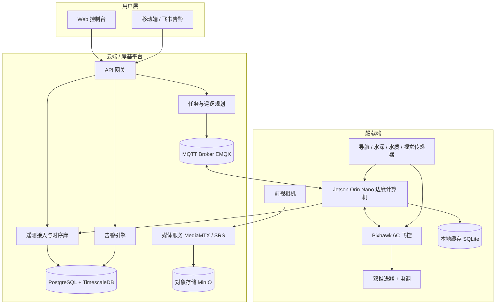
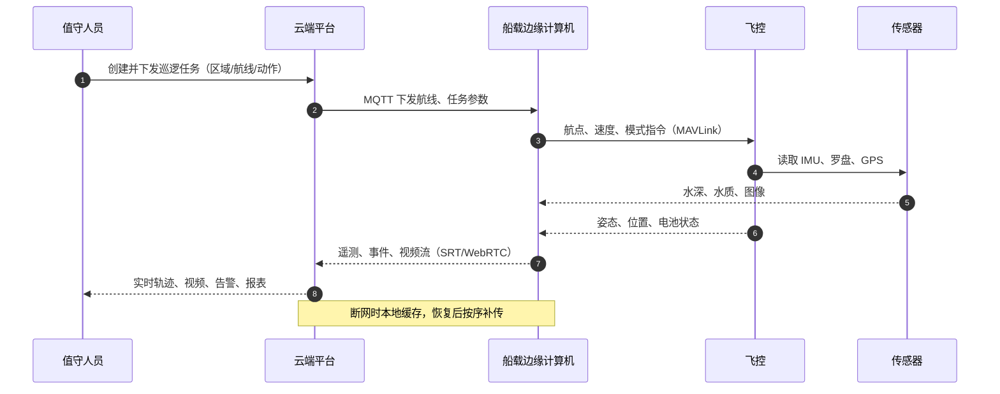
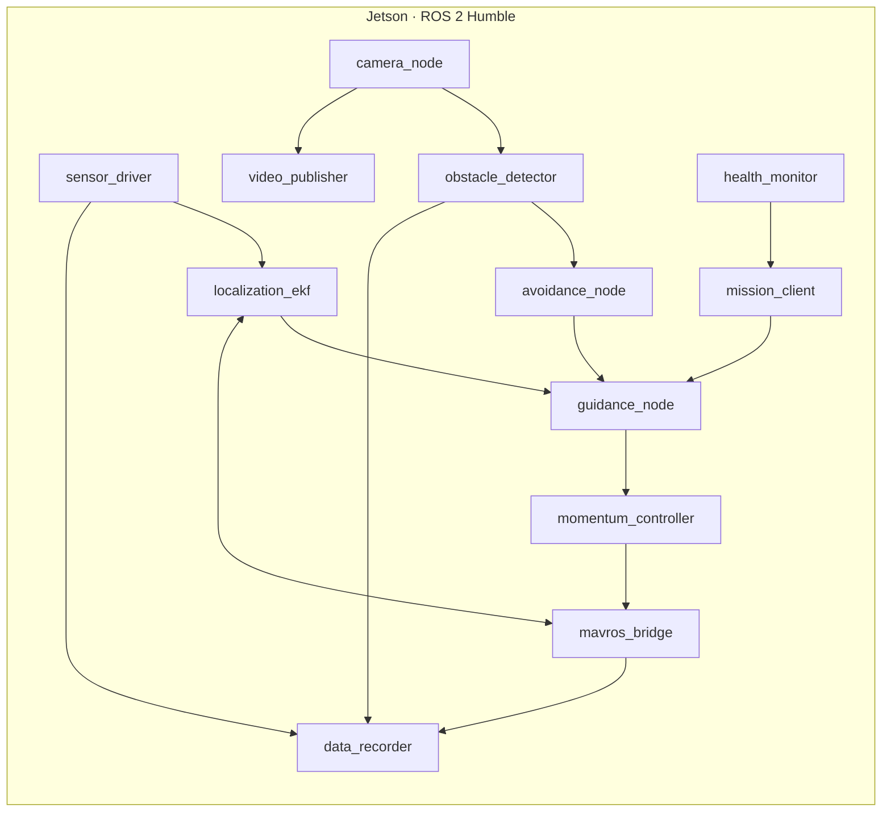

# 水库巡查机器人实现方案

| 项目 | 内容 |
| --- | --- |
| 版本 | v1.0 |
| 日期 | 2026-11-07 |
| 状态 | 方案设计（可评审） |
| 适用对象 | 水库、湖泊、水源地等封闭/半封闭水域的无人巡查船 |
| 覆盖范围 | 嵌入式硬件、导航与控制、视觉避障、水深/水质感知、后台巡逻与数据管理、控制台与实时视频 |

> 本文是工程实施方案基线。文中器件型号为满足指标的典型选型示例，最终以打样验证、供应链询价和现场测试结果为准；性能指标中标注"目标"的数值为设计目标，需在湖试阶段实测确认。

## 文档导航

| 文档 | 主要内容 |
| --- | --- |
| [嵌入式系统与硬件方案](docs/01-embedded-hardware.md) | 双脑计算架构、GPS/RTK、IMU、罗盘、4G/5G/WiFi、电源、结构与接口 |
| [定位、导航与矢量控制](docs/02-navigation-control.md) | 多源融合定位、船舶动力学、惯性动量矢量+位置控制、LOS 制导、失效保护 |
| [视觉避障与水深/水质感知](docs/03-perception-sensing.md) | 视觉障碍检测、单目测距与 TTC、避障决策、测深、水质采样 |
| [后台巡逻、数据管理与控制台](docs/04-platform-console.md) | 自动巡逻规划、任务调度、实时数据记录、告警、Web 控制台、实时视频 |

## 1. 项目概述

### 1.1 建设目标

在水库部署一艘"自主巡逻为主、远程接管为辅"的无人巡查船，替代人工完成高频次、重复性的水面巡查工作：

- **自主巡逻**：按预设区域自动生成航线，自动航行、自动避障、低电或失联自动返航。
- **视频巡查**：船载相机实时回传，控制台可实时查看、抓拍、录像回放。
- **水质与水深**：按航点自动采集水质多参数和测深数据，形成沿程分布与趋势记录。
- **任务与数据管理**：后台统一管理任务、设备、航线、遥测、告警和报表，数据可追溯、可导出。
- **安全可控**：电子围栏、低电返航、失联返航、急停、漏水告警，任何自主决策都可被人工接管。

### 1.2 典型任务

| 任务 | 作业方式 | 主要输出 |
| --- | --- | --- |
| 日常水面巡逻 | 按库区固定航线自主巡航 | 轨迹、视频、抓拍、异常事件 |
| 水源地水质巡检 | 在采样点停船/低速采样 | pH、溶解氧、浊度、电导率、水温 |
| 水深与淤积监测 | 沿断面或网格连续测深 | 水深点云、断面图、淤积趋势 |
| 漂浮物/入侵检测 | 视觉识别 + 人工确认 | 告警截图、位置、处置记录 |
| 应急巡查 | 控制台手动指定目标点，遥控/半自主前往 | 实时视频、现场数据 |
| 夜间/恶劣天气 | 降低自主等级，限速或停航 | 安全告警、返航记录 |

### 1.3 设计指标

| 类别 | 指标项 | 目标值 | 备注 |
| --- | --- | --- | --- |
| 船体 | 主尺度 | 约 2.0 m × 1.2 m × 0.5 m | 双体船，模块化载荷 |
| 船体 | 满载质量 / 吃水 | ≤ 55 kg / ≤ 0.22 m | 含电池与传感器 |
| 航行 | 巡航 / 最大航速 | 1.2–1.5 m/s / ≥ 3 m/s | 平静水面 |
| 航行 | 续航 | ≥ 4 h @ 1.2 m/s | 70% 放电深度，平静水面 |
| 环境 | 抗风浪 | 4 级风、0.4 m 浪（限速） | 超限自动返航 |
| 定位 | RTK 固定解 | ≤ 0.02 m + 1 ppm | 水平，开阔水域 |
| 定位 | 单点 GPS | ≤ 2.5 m | RTK 失锁降级 |
| 航向 | 罗盘校准后 | ≤ ±1° | 无强磁干扰 |
| 控制 | 航迹跟踪 RMSE | ≤ 1.0 m（静水）/ ≤ 2.0 m（4 级风） | 直线段统计 |
| 控制 | 定点保持 | ≤ 1.5 m | 静水 |
| 通信 | 链路 | 4G/5G 为主，WiFi 为辅 | 双链路自动切换 |
| 通信 | 遥控/遥测时延 | ≤ 500 ms | 端到端，正常网络 |
| 视频 | 实时视频 | 720p@25 fps，端到端 ≤ 1 s | WebRTC/SRT |
| 视频 | 录像留存 | 船端 ≥ 7 天，云端 ≥ 30 天 | 可配置 |
| 测深 | 量程 / 精度 | 0.3–100 m / ±1% ±0.1 m | 200 kHz 单波束 |
| 水质 | 参数 | pH、溶解氧、浊度、电导率、水温 | 可选氨氮/叶绿素 |
| 水质 | 采样周期 | 1–10 s 可配 | 按航点或连续 |
| 防护 | 舱体防护 / 工作温度 | IP67 / −5–45 ℃ | 存储 −10–55 ℃ |
| 自主 | 自主等级 | 遥控 + 自主航点/巡逻 + 自动返航 | 人工可随时接管 |
| 安全 | 保护 | 电子围栏、低电返航、失联返航、急停、漏水告警 | 独立于主控 |

### 1.4 设计原则

1. **安全优先、分层失效**：安全保护由飞控和硬件独立实现，不依赖上层视觉/规划程序；任何软件异常都应落到"减速—停船—返航"的安全状态。
2. **双脑架构、职责分离**：实时飞行控制跑在 Pixhawk/ArduPilot 上，感知、规划、视频和数据缓存在 Jetson 上；两者通过 MAVLink 交互，互不阻塞。
3. **边缘自治**：断网时船端仍能按已加载航线自主完成任务并本地缓存数据，网络恢复后自动补传。
4. **模块化与可维护性**：传感器、推进、电池、载荷分舱布置，接口标准化，便于更换和扩展。
5. **够用、可靠、低成本**：视觉避障采用"轻量检测 + 几何测距 + 规则决策"的简单方案，不追求全场景自动驾驶，优先保证可靠触发和可解释性。
6. **数据可追溯**：所有遥测、采样、告警、操作均带时间戳、位置和质量标记，支持审计与导出。

## 2. 总体架构

### 2.1 分层架构

系统按"船载感知执行层—船载边缘计算层—云端平台层—用户应用层"组织：

### 2.2 数据流

### 2.3 关键设计决策

| 决策点 | 选择 | 理由 | 备选 |
| --- | --- | --- | --- |
| 船型 | 双体船 + 双推进器差速 | 稳性好、浅吃水、低速机动灵活、结构简单 | 单体船 + 舵机 |
| 控制架构 | Pixhawk 6C + Jetson Orin Nano | 实时安全控制与复杂感知解耦，生态成熟 | STM32H7 + 树莓派 |
| 定位 | RTK F9P + IMU + 罗盘 EKF | 厘米级定位，航向稳定，低速可控 | 单点 GPS + 视觉里程计 |
| 通信 | 4G/5G + WiFi 双链路 | 库区覆盖 + 靠岸高速，自动切换 | LoRa + 岸基网桥 |
| 视频 | SRT 上行 + WebRTC 下行 | 抗丢包、低延迟，浏览器免插件 | RTMP + HLS |
| 数据 | PostgreSQL/TimescaleDB + MinIO | 任务数据与遥测统一 SQL，媒体对象化 | InfluxDB + 文件存储 |
| 部署 | Docker Compose（试点）/ K8s（扩容） | 试点快速交付，后续平滑扩容 | 纯 K8s |
| 边缘缓存 | SQLite 队列 + 断点续传 | 库区信号盲区不丢数据 | 仅云端存储 |

### 2.4 需求与方案对应关系

| 原始需求 | 实现方式 | 详细章节 |
| --- | --- | --- |
| 1. 嵌入式方案，接入 GPS、WiFi、移动网络、惯性传感、方位传感器 | Pixhawk + Jetson 双脑；RTK GPS、4G/5G、WiFi、IMU、磁罗盘统一接入与时间同步 | [01 硬件](docs/01-embedded-hardware.md) |
| 2. 船舶惯性动量矢量和位置定位控制算法 | 以广义动量 `p = Mν` 为被控量，位置/航向外环 + 速度/动量内环 + 前馈补偿与推力分配 | [02 控制](docs/02-navigation-control.md) |
| 3. 简单视觉避障算法 | 轻量目标检测 + 水面几何测距 + TTC 风险分级 + 规则/势场避让，近距传感器兜底 | [03 感知](docs/03-perception-sensing.md) |
| 4. 水深传感、水质传感器 | 200 kHz 单波束测深 + 多参数水质探头（RS485/Modbus），姿态与吃水修正 | [03 感知](docs/03-perception-sensing.md) |
| 5. 后台自动巡逻规划管理系统、实时数据记录管理系统 | 区域覆盖规划、任务状态机、MQTT 调度、时序库、断网续传、告警与报表 | [04 平台](docs/04-platform-console.md) |
| 6. 控制台实时查看视频 | Web 控制台 + SRT/WebRTC 视频链路 + 录像回放 + 多码率自适应 | [04 平台](docs/04-platform-console.md) |

## 3. 系统组成

| 子系统 | 主要部件 | 职责 |
| --- | --- | --- |
| 船体与结构 | 双体船壳、设备舱、载荷架、防撞条 | 提供浮力、稳性、防护与载荷安装 |
| 动力与推进 | 2× 水下推进器、双向电调、急停 | 差速推进、前进/倒车/原地转向 |
| 导航与控制 | Pixhawk 6C、RTK GPS、IMU、磁罗盘、遥控接收机 | 姿态解算、位置融合、航点/速度控制、失效保护 |
| 边缘计算 | Jetson Orin Nano、NVMe、4G/5G 路由器、WiFi | 视觉避障、任务执行、数据缓存、视频编码 |
| 感知载荷 | 前视相机、测深仪、水质多参数探头 | 视频、水深、水质数据采集 |
| 通信 | 4G/5G、WiFi、可选岸基网桥、天线 | 遥测、指令、视频、OTA |
| 电源 | 25.6 V LiFePO4 电池、BMS、DC-DC、充电器 | 供电、保护、电量计量 |
| 云端平台 | 任务、遥测、告警、媒体、存储服务 | 巡逻规划、数据管理、视频分发 |
| 控制台 | Web 前端（地图/视频/图表/任务编辑） | 监视、控制、任务编排、回放 |

## 4. 软件架构与部署

### 4.1 船端软件

船端以 Ubuntu 22.04 + ROS 2 Humble 为基础，Pixhawk 运行 ArduPilot Rover 固件，Jetson 运行感知、制导、任务与数据节点：

| 节点/进程 | 频率 | 职责 |
| --- | --- | --- |
| `sensor_driver` | 5–50 Hz | GPS、IMU、罗盘、测深、水质串口/网络解析 |
| `camera_node` | 30 FPS | 相机采集、时间戳、去畸变、图像分发 |
| `localization_ekf` | 100 Hz | 多源融合，输出位置、速度、航向与协方差 |
| `mission_client` | 1–5 Hz | 接收/缓存任务，管理航点与动作，断点续行 |
| `guidance_node` | 20 Hz | LOS 路径跟踪、速度规划、避障航向修正 |
| `momentum_controller` | 50 Hz | 动量/速度/位置控制，推力分配 |
| `mavros_bridge` | 50 Hz | MAVLink 与 ROS 2 消息转换，模式/安全指令 |
| `obstacle_detector` | ≥ 20 FPS | 目标检测、测距、跟踪、风险输出 |
| `avoidance_node` | 20 Hz | 风险分级、候选航向评估、减速/绕行/停船 |
| `video_publisher` | 25 FPS | 硬件编码、SRT/RTSP 推流、双码流 |
| `data_recorder` | 事件/1 Hz | 遥测、采样、图像本地缓存与补传 |
| `health_monitor` | 1 Hz | 进程、温度、磁盘、网络、传感器健康 |

### 4.2 云端服务

| 服务 | 技术建议 | 职责 |
| --- | --- | --- |
| API 网关 | Nginx / Traefik | 统一入口、TLS、限流、鉴权 |
| 认证与权限 | FastAPI + JWT + RBAC | 用户、角色、设备权限 |
| 设备服务 | FastAPI | 设备注册、在线状态、固件版本、配置下发 |
| 任务服务 | FastAPI + PostGIS | 任务 CRUD、区域建模、航线生成、状态机 |
| 遥测服务 | FastAPI + MQTT 客户端 | 数据接入、校验、写时序库、WebSocket 推送 |
| 告警服务 | FastAPI + 规则引擎 | 阈值/持续/变化率规则，通知与确认 |
| 媒体服务 | MediaMTX / SRS | SRT/RTSP 接入、WebRTC/HLS 分发、录像 |
| 报表服务 | FastAPI + Pandas | 巡逻统计、水质趋势、水深断面、导出 |
| Web 控制台 | Vue 3 + TypeScript + Vite | 地图、视频、图表、任务编辑、回放 |

### 4.3 部署形态

| 阶段 | 部署方式 | 规格建议 |
| --- | --- | --- |
| 试点 | 单机 Docker Compose | 8C/16G/500GB SSD + 2TB 视频盘 |
| 小规模 | 双机（应用 + 数据/媒体） | 应用 8C/16G，数据 8C/32G + 4TB |
| 扩容 | K8s 三节点 | 按船数与视频路数水平扩展 |

船端与云端通过 WireGuard VPN 组成内网，MQTT 使用 TLS（8883），视频使用 SRT（UDP）或 WebRTC（TURN 兜底）；公网仅暴露 443 与必要的媒体端口。

### 4.4 网络、安全与运维

- **身份与鉴权**：设备一机一密（证书/密钥），用户 JWT + RBAC，接口按角色授权。
- **传输安全**：MQTT over TLS、HTTPS、SRT 加密（可选 AES）、VPN 隧道。
- **数据安全**：数据库定期备份，媒体对象存储桶私有，视频访问使用短时签名 URL。
- **OTA**：船端采用 A/B 分区或容器镜像回滚，升级前校验签名与电量，升级失败自动回退。
- **可观测性**：Prometheus + Grafana 监控服务与船端指标，Loki 收集日志；船端保留最近 7 天运行日志。
- **远程运维**：SSH 仅经 VPN，操作留痕；关键配置变更需二次确认。

## 5. 实施计划

### 5.1 阶段与里程碑

| 阶段 | 周期 | 主要工作 | 交付物 |
| --- | --- | --- | --- |
| P0 方案与选型 | 2 周 | 需求确认、指标分解、器件选型、接口定义 | 本方案、BOM、接口文档 |
| P1 船体与电气 | 4 周 | 船体加工、推进/电源/通信安装、防水测试 | 可遥控航行的原型船 |
| P2 导航与控制 | 4 周 | 传感器标定、EKF、动量控制、LOS、失效保护 | 自主航点与定速巡航 |
| P3 视觉避障 | 3 周 | 数据采集、模型训练、测距、避障决策、集成 | 避障演示与测试报告 |
| P4 水深与水质 | 2 周 | 探头安装、Modbus 解析、姿态修正、采样流程 | 沿程测深/水质数据 |
| P5 平台与控制台 | 4 周 | 任务规划、遥测、告警、视频、回放 | 可用的 Web 平台 |
| P6 联调与湖试 | 3 周 | 水池/湖试、断网/低电/失联/避障专项 | 测试报告、问题清单 |
| P7 试点与验收 | 2 周 | 连续运行、用户培训、验收 | 验收报告、运维手册 |

P1–P5 可部分并行，关键路径约 18–20 周；建议设置 2 周缓冲。

### 5.2 MVP 建议

先交付"可遥控 + 可自主定线 + 视频 + 遥测 + 基础水深/水质"的最小可用版本（约 8–10 周），验证船体、通信和数据的闭环，再迭代视觉避障、自动任务规划和多船调度。这样可以把"船能不能稳定跑、视频能不能稳定回传"这两个最大不确定性前置暴露。

### 5.3 团队配置

| 角色 | 人数 | 主要职责 |
| --- | --- | --- |
| 项目经理/系统工程师 | 1 | 需求、计划、接口、验收 |
| 结构/电气工程师 | 1 | 船体、舵机/推进、电源、防水 |
| 嵌入式工程师 | 2 | 飞控、传感器、通信、边缘集成 |
| 控制算法工程师 | 1 | 定位融合、制导、动量控制、参数辨识 |
| 视觉算法工程师 | 1 | 检测、测距、避障决策、数据标注 |
| 后端工程师 | 2 | 任务、遥测、告警、媒体、部署 |
| 前端工程师 | 1 | 控制台、地图、视频、报表 |
| 测试/运维 | 1 | 测试计划、湖试、运维 |

### 5.4 成本估算

以下为单套原型的小批量估算（人民币，含税，不含研发人力与测试水域费用）：

| 项目 | 估算区间 | 说明 |
| --- | --- | --- |
| 船体与结构 | 8,000–15,000 | 双体船壳、舱体、支架、防撞 |
| 推进与电调 | 4,000–6,000 | 2× 推进器、双向电调、急停 |
| 飞控与导航 | 4,000–8,000 | Pixhawk、RTK 基站/流动站、IMU、罗盘 |
| 边缘计算 | 3,000–4,500 | Jetson Orin Nano、NVMe、散热 |
| 相机与云台 | 1,000–3,000 | 前视广角，可选云台 |
| 测深仪 | 5,000–15,000 | 200 kHz 单波束，含换能器 |
| 水质探头 | 10,000–25,000 | 五参数，可选氨氮/叶绿素 |
| 通信 | 1,500–3,000 | 4G/5G 路由器、WiFi、天线 |
| 电池与充电 | 4,000–7,000 | 25.6 V/40 Ah LiFePO4、BMS、充电器 |
| 线缆与杂项 | 3,000–5,000 | 防水接头、传感器、指示灯 |
| **合计** | **约 44,000–92,000** | 小批量可降至 35,000–60,000 |

### 5.5 关键路径与前置条件

- 测试水域与作业许可：提前联系水库管理单位，明确禁航区、取水口、泄洪区。
- 无线电频率与功率：4G/5G、WiFi、遥控链路需符合当地无线电管理要求。
- RTK 基准站：确认库区是否有可用的 CORS 账号，或自建基准站/网络 RTK。
- 供应链：测深仪、水质探头交期通常较长，需提前锁货。
- 安全员与保险：首飞/首航、湖试期间安排安全员与救援船。

## 6. 测试与验收

### 6.1 测试策略

| 层级 | 方法 | 重点 |
| --- | --- | --- |
| 单元测试 | pytest / gtest | 控制律、坐标变换、规划器、协议解析 |
| 软件在环 SIL | Gazebo + VRX | 风浪流、航点跟踪、避障、失效注入 |
| 硬件在环 HIL | Pixhawk + Jetson | MAVLink、传感器时序、模式切换 |
| 水池试验 | 静水水池 | 定点、直线、转弯、急停、漏水保护 |
| 湖试 | 真实水库 | 续航、通信盲区、断网续传、避障、低电/失联返航 |
| 长稳 | 72 h 平台 + 连续任务 | 内存、磁盘、重连、数据完整性 |

### 6.2 验收指标

| 项目 | 验收标准 |
| --- | --- |
| 自主巡逻 | 按计划完成≥5 条不同航线，任务完成率≥95% |
| 航迹精度 | 直线段 RMSE ≤1.5 m（≤3 级风） |
| 定点保持 | 半径 ≤2 m，持续 10 min |
| 避障 | 典型漂浮物/船只场景检出率≥95%，无误撞；响应 ≤500 ms |
| 视频 | 720p@25 连续 30 min，卡顿率≤2%，端到端延迟≤1.5 s |
| 通信 | 库区常规航段在线率≥95%，断网恢复后数据完整率≥99% |
| 测深 | 与人工测深比对，误差满足 ±1% ±0.1 m |
| 水质 | 与实验室比对，pH/DO/浊度/电导/温度满足探头标称精度 |
| 安全 | 低电、失联、越界、急停四类保护 100% 触发并返航/停船 |
| 数据 | 任务、遥测、告警、媒体可查询、可导出、可追溯 |

### 6.3 湖试大纲

1. **通航与通信**：绕库区主航段一周，记录 4G/5G 信号、切换、丢包与视频质量。
2. **控制性能**：直线、圆、S 弯、定点保持，记录 RMSE 与超调。
3. **任务执行**：完整巡逻任务 + 采样点停船 + 断点续行。
4. **避障**：布置浮标/漂浮物/模拟船只，测试发现距离、减速、绕行、停船。
5. **失效注入**：断网、断电重启、GPS 失锁、罗盘干扰、低电、越界、漏水。
6. **数据完整性**：断网 10 min 后恢复，核对遥测/采样/视频补传完整性。

## 7. 风险与应对

| 风险 | 影响 | 应对 |
| --- | --- | --- |
| 库区 4G 信号弱/盲区 | 视频卡顿、失联 | 双卡/双运营商、WiFi/岸基网桥、船端缓存、低码率自适应 |
| RTK 失锁/多路径 | 定位漂移 | 双天线航向、EKF 降级、限速、围栏保护、开阔水域作业 |
| 磁罗盘受电机/电流干扰 | 航向错误 | 罗盘远离动力线、椭球校准、双罗盘冗余、RTK 航向融合 |
| 水质探头生物附着/漂移 | 数据失真 | 流通池、铜网防附着、定期清洗校准、质量标记 |
| 强光/雨雾/夜间视觉失效 | 避障漏检 | 近距超声/毫米波兜底、限速、夜间不开启自主避障 |
| 风浪流干扰 | 航迹偏差、能耗上升 | 推力余量、抗扰控制、风浪超限返航 |
| 电池/推进故障 | 失控或漂失 | 低电返航、失联悬停/返航、应急浮标、救援预案 |
| 法规与水域许可 | 无法作业 | 提前报备、安全员、保险、限航区 |
| 供应链交期 | 进度延误 | 关键器件提前锁货、国产替代验证 |
| 数据安全/隐私 | 合规风险 | 最小化采集、加密、权限、留存策略、视频水印 |

## 8. 后续扩展

- 自动充电坞/换电，支持 24 h 值守。
- 多船协同与任务分配，覆盖大库区。
- 2D LiDAR/毫米波/声呐融合避障，提升夜间与雨雾能力。
- 水质预测、藻华预警、淤积三维建模。
- 边缘 AI 升级（模型量化、蒸馏）与云端模型迭代。
- 数字孪生与库区三维可视化。

## 9. 待确认事项（用于深化设计）

以下信息需要在详细设计前与使用方确认，当前方案按通用水库场景给出假设：

- 库区水域面积、形状、岛屿/网箱分布、平均与最大水深、水位年变幅。
- 是否已有 RTK 基准站或 CORS 账号；库区 4G/5G 运营商信号实测情况。
- 水质监测参数清单、采样频次、是否要求实验室比对与 CMA/CNAS 报告。
- 视频路数、留存期限、是否需要夜间/热成像、是否接入现有监控平台。
- 码头/充电条件、日常维护人员与响应时间、是否需要自动充电坞。
- 预算区间、期望交付时间、当地水域作业与无线电使用许可要求。

## 附录 A 术语

| 术语 | 说明 |
| --- | --- |
| USV | Unmanned Surface Vehicle，无人水面艇 |
| RTK | 实时动态差分定位，厘米级 |
| EKF | 扩展卡尔曼滤波 |
| LOS | Line of Sight，视线导引 |
| TTC | Time To Collision，碰撞时间 |
| NMEA | 航海设备串口数据协议 |
| MQTT | 轻量级发布/订阅消息协议 |
| RTL | Return to Launch，自动返航/返航点 |
| SRT | Secure Reliable Transport，低延迟抗丢包传输 |
| WebRTC | 浏览器实时音视频通信 |
| DO | 溶解氧 |
| DOD | 放电深度 |

## 附录 B 参考规范

- 水库大坝安全管理、水源地保护及水域作业相关规定（以项目所在地现行文件为准）。
- 《中华人民共和国无线电管理条例》及地方无线电管理要求。
- 《数据安全法》《个人信息保护法》及视频监控相关合规要求。
- 无人船/船舶电气、防护、电磁兼容相关国家/行业标准（选型与验收时核对最新版本）。
