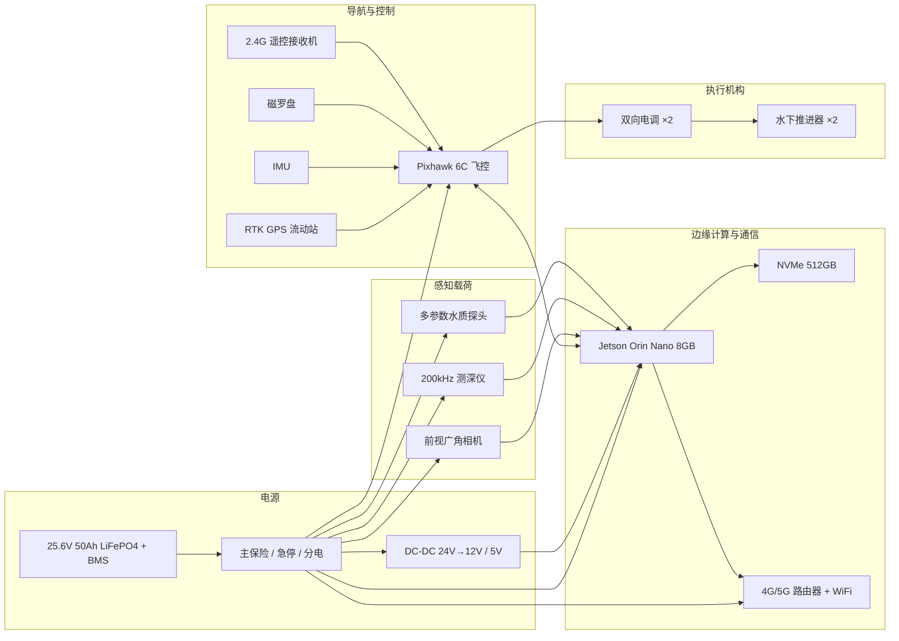
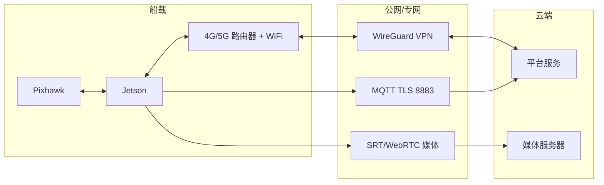
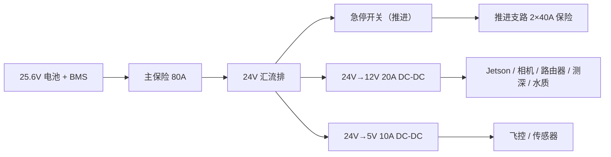

# 1. 嵌入式系统与硬件方案

本分册对应需求 1：采用嵌入式系统方案，接入 GPS、WiFi、移动网络、惯性传感与方位传感器。目标是把导航、控制、感知、通信和电源集成为一艘可维护、可扩展的无人船。

## 1.1 设计目标与约束

- **实时性**：姿态/位置控制与安全保护必须在毫秒级确定性地执行，不能被视觉或网络任务阻塞。
- **算力**：前视视频 720p@25、轻量目标检测、测深/水质解析、数据缓存并行运行。
- **功耗**：整船巡航平均功耗控制在 200 W 以内，保证 4 h 续航。
- **防护**：设备舱 IP67，接插件防水，天线外置，舱内可维护。
- **电磁兼容**：GPS、罗盘远离电机、电调和 4G 天线，避免磁干扰与射频阻塞。
- **可维护**：电池、推进器、传感器模块可快速拆换，故障可通过日志定位。

## 1.2 硬件总体框图

## 1.3 计算与控制单元

### 1.3.1 双脑架构

| 单元 | 示例型号 | 运行内容 | 作用 |
| --- | --- | --- | --- |
| 实时控制 | Pixhawk 6C（STM32H743） | ArduPilot Rover 4.5+ | IMU/罗盘/GPS 融合、姿态与速度控制、航点、失效保护、电调输出 |
| 边缘计算 | Jetson Orin Nano 8GB | Ubuntu 22.04 + ROS 2 Humble | 视觉避障、制导、任务管理、数据缓存、视频编码 |
| 通信 | 4G/5G 工业路由器 + WiFi AP | OpenWrt/Linux | 双链路、VPN、NAT、看门狗 |
| 存储 | NVMe 512GB | ext4 | 录像、日志、遥测缓存 |

**职责边界**：

- 飞控负责"船不失控"：姿态稳定、位置/速度闭环、电子围栏、低电/失联返航、遥控优先。
- Jetson 负责"船会干活"：任务解析、航线跟踪、视觉避障、数据采集与上传。
- 两侧通过 MAVLink（UART/USB，57600–921600 bps）交互。Jetson 异常时飞控进入自主返航或悬停等待，不依赖 Jetson 的存活。

### 1.3.2 计算平台对比

| 平台 | 算力 | 功耗 | 视频编解码 | 适用性 |
| --- | --- | --- | --- | --- |
| Jetson Orin Nano 8GB | 40 TOPS（INT8，稀疏） | 7–15 W | 硬件 H.264/H.265 | **推荐**：TensorRT 生态成熟，可跑轻量检测 + 多路数据 |
| RK3588 | 6 TOPS NPU | 5–12 W | 8K 解码，编码能力强 | 降本备选：需适配 RKNN，模型转换成本较高 |
| Raspberry Pi 5 8GB | 无独立 NPU | 5–10 W | 无硬件编码（需外接） | 不推荐做主感知，可做通信/数据从机 |

### 1.3.3 任务分配与实时性

| 任务 | 运行单元 | 频率 | 实时性要求 |
| --- | --- | --- | --- |
| IMU 采样与姿态解算 | 飞控 | 200–400 Hz | 硬实时 |
| 位置融合（EKF） | 飞控 | 50–100 Hz | 硬实时 |
| 速度/位置控制 | 飞控 | 50 Hz | 硬实时 |
| 失效保护与模式切换 | 飞控 | 50 Hz | 硬实时 |
| 视觉检测 | Jetson | ≥ 20 FPS | 软实时 |
| 制导与避障 | Jetson | 20 Hz | 软实时 |
| 遥测/视频/数据 | Jetson | 1–25 Hz/FPS | 尽力而为 |

### 1.3.4 启动、看门狗与降级

- Jetson 与飞控独立上电，飞控先启动并进入 `HOLD`，等待 Jetson 心跳。
- Jetson 通过 GPIO/MAVLink 心跳喂狗；连续 2 s 无心跳，飞控切到 `RTL` 或 `HOLD`（可配置）。
- 4G 路由器独立看门狗，断网自动重连；连续 5 min 无法联网则重启模组。
- 关键进程由 systemd 或容器 restart policy 拉起；连续崩溃 3 次上报并进入安全模式。

## 1.4 传感器配置

| 传感器 | 示例型号 | 接口 | 频率 | 供电 | 用途 |
| --- | --- | --- | --- | --- | --- |
| RTK GPS | u-blox ZED-F9P（Holybro H-RTK F9P） | UART/USB，NMEA/UBX | 5–10 Hz | 5 V / 0.3 A | 厘米级定位、速度、时间 |
| IMU | ICM-42688-P（飞控内置） | SPI | 200–400 Hz | 3.3 V | 加速度、角速度 |
| 磁罗盘 | IST8310（外置，桅杆安装） | I2C | 50 Hz | 3.3 V | 航向（方位） |
| 测深仪 | 200 kHz 单波束测深模块 | RS232，NMEA DBT/DPT | 5 Hz | 12 V / 0.3 A | 水深 |
| 水质探头 | 五参数（pH/DO/浊度/电导/温度） | RS485，Modbus RTU | 1 Hz/按需 | 12 V / 0.2 A | 水质 |
| 前视相机 | IMX477 / IMX219（广角） | CSI-2 | 30 FPS | 5 V / 0.3 A | 视频与避障 |
| 漏水传感器 | 电极式/光电式 | GPIO | 1 Hz | 3.3 V | 舱内进水告警 |
| 舱温/湿度 | SHT31 | I2C | 1 Hz | 3.3 V | 舱内环境 |
| 电流/电压 | INA226 / 飞控电源模块 | I2C/ADC | 10 Hz | 3.3 V | 功耗与电量 |
| 可选毫米波 | 24/77 GHz 近距模块 | UART/CAN | 20 Hz | 12 V | 近距避障兜底 |
| 可选 2D LiDAR | 低成本 TOF 雷达 | Ethernet/UART | 10 Hz | 12 V | 夜间/雨雾辅助 |

### 1.4.1 GPS/RTK

- 使用多频多系统（GPS/北斗/GLONASS/Galileo）模块，支持 RTCM 差分输入。
- 差分来源优先级：库区 CORS 网络 RTK（NTRIP）→ 自建基准站 → 单点降级。
- 安装于桅杆顶部，配 100 mm 金属地平面，尽量远离 4G/5G 天线（≥30 cm）和摄像头排线。
- 输出定位质量（fix type、卫星数、HDOP、基线长度），平台据此标记数据质量并在 RTK 失锁时降级。
- 可选双天线（moving baseline）获取航向，低速和强磁干扰环境下比磁罗盘更稳；本方案默认单天线 + 罗盘，双天线作为增强项。

### 1.4.2 IMU 与磁罗盘

- IMU 使用飞控内置 ICM-42688-P，必要时外置 ADIS16470 提升抗振性能。
- 罗盘安装在桅杆顶部，远离电机、电调、电池主线和 4G 天线；线缆双绞并屏蔽。
- 校准：硬磁/软磁椭球拟合 + 倾斜补偿；每次更换载荷或走线后重新校准；记录校准残差。
- 冗余：飞控内置罗盘 + 外置罗盘，偏差过大时告警并切换；RTK 双天线航向可作第三方校验。

### 1.4.3 测深仪

- 200 kHz 单波束，量程 0.3–100 m，RS232 输出 NMEA 0183（DBT/DPT）。
- 换能器安装于船底最低点、远离推进器尾流和气泡，声束垂直向下；周围做导流罩。
- 支持外置温度补偿；淡水默认声速 1480 m/s，可按实测温度修正。
- 详见 [03 感知分册](03-perception-sensing.md)。

### 1.4.4 水质探头

- 五参数：pH、溶解氧、浊度、电导率、水温；可选氨氮、叶绿素、蓝绿藻。
- RS485 Modbus RTU，9600/19200 8N1，地址可配；12 V 供电，支持休眠。
- 安装方式：流通池（推荐，泵抽水）或直接浸没；进水口加可拆卸滤网，生物附着严重时可用铜网，但监测铜/重金属指标时禁用铜网。
- 详见 [03 感知分册](03-perception-sensing.md)。

### 1.4.5 视觉相机

- 前视广角，水平视场角 ≥ 90°，1080p@30，优先全局快门以减少横摇拖影。
- 安装高度约 0.6 m，俯仰约 5°，尽量靠近船体中轴线，避免遮挡。
- IP67 防护罩 + 光学窗，内置干燥剂/加热片防雾；镜头定期清洁。
- 预留第二路（后视/下视）接口，用于靠泊和采样观察。

### 1.4.6 安全传感器

- 舱内漏水：双电极，任意一处触发即告警并建议返航。
- 电池温度/电流：BMS + 霍尔电流传感器，过流/过温分级保护。
- 舱温：高温降频/降载，低温禁充电。
- 航行灯、蜂鸣器、实体急停按钮：便于现场识别与人工切断动力。

### 1.4.7 安装要点

| 设备 | 安装位置 | 关键要求 |
| --- | --- | --- |
| GPS 天线 | 桅杆顶部 | 视天空开阔，地平面，远离射频源 |
| 磁罗盘 | 桅杆顶部、GPS 下方 | 远离动力线 ≥30 cm，水平安装 |
| 4G/5G 天线 | 桅杆两侧，分集 | 与 GPS/罗盘隔离，避免同轴干扰 |
| 测深换能器 | 船底最低点 | 垂直向下，避气泡，导流罩 |
| 水质进水口 | 船底/舷侧 | 远离推进器尾流，防堵塞 |
| 前视相机 | 船首上方 | 视线无遮挡，俯仰 5°，可调 |
| 电池 | 船体中部低处 | 降低重心，固定牢靠，通风/防火 |

## 1.5 通信设计

### 1.5.1 链路

| 链路 | 用途 | 频段/制式 | 备注 |
| --- | --- | --- | --- |
| 4G/5G | 遥测、指令、视频、OTA | 运营商公网 | 主链路，双卡/双运营商可选 |
| WiFi | 靠岸/码头高速数据、调试 | 2.4/5 GHz | 自动切换，优先级高于 4G |
| 2.4G 遥控 | 人工应急接管 | 2.4 GHz FHSS | 独立于数据链，安全兜底 |
| 可选岸基网桥 | 库区固定航线覆盖 | 5.8 GHz / 900 MHz | 无 4G 覆盖时补充 |
| 可选卫星 | 超远距离应急 | 北斗短报文 | 仅传位置与告警 |

### 1.5.2 网络拓扑

### 1.5.3 带宽预算

| 业务 | 上行带宽 | 说明 |
| --- | --- | --- |
| 遥测 | 20–50 kbps | 1–10 Hz，JSON/Protobuf |
| 指令 | < 10 kbps | 事件驱动 |
| 实时视频 720p@25 | 1.2–2.0 Mbps | H.264，按网络自适应 |
| 实时视频 1080p@25 | 3.5–5.0 Mbps | 弱网自动降码率 |
| 图片/日志补传 | 按需 | 断网恢复后批量上传 |
| 合计（常规） | 1.5–2.5 Mbps | 建议 4G 上行 ≥ 4 Mbps |

### 1.5.4 断线与切换策略

- 每 5 s 心跳，连续 3 次丢失判定链路异常；WiFi 可用时优先 WiFi，否则 4G/5G。
- 断网时任务继续执行，遥测/事件写本地 SQLite 队列（WAL），视频本地录制。
- 网络恢复后按时间序补传，带唯一 ID 与校验和，平台幂等入库。
- 双卡场景按信号强度/资费/流量策略切换，切换期间视频降为 480p。

### 1.5.5 天线与防护

- 4G/5G 主分集天线分开布置，间距 ≥ 1/4 波长；避免与 GPS 天线共杆太近。
- 所有外置接插件使用防水航插（IP67/IP68），螺纹处涂防水胶。
- 天线馈线做防水弯（滴水弯），接头处热缩管密封。

## 1.6 电源与配电

### 1.6.1 电池

| 项目 | 参数 |
| --- | --- |
| 化学体系 | LiFePO4（磷酸铁锂） |
| 配置 | 8S1P，25.6 V，50 Ah，约 1.28 kWh |
| 持续/峰值放电 | 60 A / 100 A |
| BMS | 8S 100 A，带过充/过放/过流/过温/均衡 |
| 充电 | 29.2 V / 20 A 专用充电器，约 2.5–3 h |
| 防护 | IP67 电池箱，阻燃材料，独立舱 |

### 1.6.2 功耗预算

| 负载 | 巡航功率 | 峰值功率 | 备注 |
| --- | --- | --- | --- |
| 推进器 ×2 | 120 W | 700 W | 巡航 1.2–1.5 m/s |
| Jetson Orin Nano | 15 W | 25 W | 检测+编码 |
| 飞控/IMU/GPS/罗盘 | 5 W | 6 W | — |
| 4G/5G 路由器 | 5 W | 10 W | 弱信号时升高 |
| WiFi | 3 W | 5 W | 靠岸时 |
| 相机 ×2 | 4 W | 5 W | — |
| 测深仪 | 3 W | 10 W | 发射峰值 |
| 水质探头 | 2 W | 3 W | 采样时 |
| 航灯/蜂鸣/传感器 | 4 W | 6 W | — |
| DC-DC 与线损（约 10%） | 16 W | 25 W | — |
| **合计** | **约 177 W** | **约 795 W** | 巡航续航约 5 h（70% DOD，理论值；任务按 4 h 规划） |

### 1.6.3 配电与保护

- 主回路 80 A 保险，推进支路各 40 A，其余支路独立保险。
- 急停切断推进动力，保留飞控、通信、灯光和定位供电，便于回收与定位。
- 电池低压阈值：24.0 V 告警、23.2 V 强制返航、22.4 V 停船待命（参数可调）。
- 所有 DC-DC 输入端加 TVS 与滤波，推进电调加续流与去耦电容，减少对 GPS/罗盘的干扰。

### 1.6.4 充电与换电

- 原型阶段采用人工换电/插充，充电区设置防火隔离。
- 预留自动充电坞接口（正负极 + CAN/RS485 通信），二期实现自动回坞充电。

## 1.7 结构与防护

- **船型**：双体船，两个片体 + 中央设备舱，HDPE 或玻璃钢成型；片体提供浮力与航向稳定性。
- **分舱**：电池舱、电子舱、载荷舱独立，舱间穿线用防水接头；电子舱可开启维护。
- **浮力**：船体填充闭孔泡沫或设置独立浮力舱，单舱进水仍可漂浮。
- **防护**：舱盖 O 型圈密封，IP67；所有线缆出口做防水弯；舱内放干燥剂/湿度传感器。
- **散热**：Jetson 与 4G 路由器加导热块/风扇，舱内温度超过 55 ℃ 降频，超过 65 ℃ 停机保护。
- **防腐蚀**：海水/咸水场景选用 316 不锈钢、阳极氧化铝、船用尼龙；淡水场景可适当降本。
- **稳性**：电池置于最低处，桅杆与相机轻量化；横摇固有周期避开常见波浪周期。
- **标识**：船体贴反光条、编号、救援联系方式；夜间开航行灯。

## 1.8 接口定义

| 接口 | 连接器 | 信号 | 电平/协议 | 备注 |
| --- | --- | --- | --- | --- |
| GPS | JST-GH 10P | 5V/GND/TX/RX/PPS | UART 3.3V，NMEA/UBX | 接飞控 GPS1 |
| 罗盘 | JST-GH 4P / I2C | 3.3V/GND/SDA/SCL | I2C | 外置桅杆 |
| 飞控↔Jetson | USB / UART | MAVLink 2 | 921600 bps | 心跳、指令、遥测 |
| 电调 ×2 | XT60/防水航插 | PWM + 电源 | 50–400 Hz PWM | 飞控 MAIN1/2 |
| 测深仪 | DB9/防水航插 | RS232 TX/RX | NMEA 0183，4800/9600 | USB 转串口接 Jetson |
| 水质探头 | M12 防水航插 | RS485 A/B | Modbus RTU | USB-RS485 接 Jetson |
| 相机 | CSI-2 排线 | MIPI | 1080p@30 | 屏蔽、固定 |
| 4G/5G | SMA | 射频 | LTE/5G NR | 主分集 |
| WiFi | SMA | 射频 | 2.4/5 GHz | 靠岸 |
| 充电 | XT90/AS150 | 29.2 V | DC | 防反接 |
| 急停 | 防水按钮 | 干接点 | — | 切断动力 |

## 1.9 BOM 清单（原型）

| 序号 | 物料 | 数量 | 单价估算（元） | 小计（元） |
| --- | --- | --- | --- | --- |
| 1 | 双体船壳 + 设备舱 | 1 | 8,000–15,000 | 8,000–15,000 |
| 2 | 24 V 水下推进器 | 2 | 1,500–2,500 | 3,000–5,000 |
| 3 | 双向电调 | 2 | 400–600 | 800–1,200 |
| 4 | Pixhawk 6C | 1 | 1,500–2,000 | 1,500–2,000 |
| 5 | RTK GPS（流动站+基准站） | 1 套 | 2,500–5,000 | 2,500–5,000 |
| 6 | 外置罗盘 + IMU | 1 | 300–800 | 300–800 |
| 7 | Jetson Orin Nano 8GB + NVMe | 1 | 3,000–4,500 | 3,000–4,500 |
| 8 | 4G/5G 路由器 + WiFi + 天线 | 1 套 | 1,500–3,000 | 1,500–3,000 |
| 9 | 前视相机 + 防护罩 | 1 | 800–2,500 | 800–2,500 |
| 10 | 200 kHz 测深仪 + 换能器 | 1 | 5,000–15,000 | 5,000–15,000 |
| 11 | 五参数水质探头 | 1 | 10,000–25,000 | 10,000–25,000 |
| 12 | 25.6 V 50 Ah LiFePO4 + BMS | 1 | 3,000–5,500 | 3,000–5,500 |
| 13 | 充电器 29.2 V 20 A | 1 | 800–1,500 | 800–1,500 |
| 14 | DC-DC、保险、线缆、接插件 | 1 套 | 3,000–5,000 | 3,000–5,000 |
| 15 | 漏水/温湿度/电流传感器、航灯 | 1 套 | 500–1,000 | 500–1,000 |
| **合计** | | | | **约 44,000–92,000** |

> 以上为单套原型含税估算，不含研发人力、测试水域、运输与备件；小批量采购可下降约 20%–30%。

## 1.10 备选与降本

- **计算**：RK3588 替代 Jetson，需将 YOLO 模型转 RKNN，精度与算子支持需验证。
- **定位**：单点 GPS + 视觉/里程计融合，成本降低但航迹精度下降到米级。
- **测深**：低成本单波束模块（精度 ±1% ±0.5 m）用于日常巡查，高精度型号用于淤积测量。
- **水质**：先上 pH/DO/浊度/温度四参数，电导率与氨氮按需扩展。
- **通信**：单卡 4G + WiFi，放弃 5G；库区有岸基网桥时可进一步降低流量成本。

## 1.11 硬件验证项

| 验证项 | 方法 | 通过标准 |
| --- | --- | --- |
| 防水 | 浸水/淋雨 30 min | 舱内无水，绝缘正常 |
| 电源 | 满载放电、过流、反接 | 保护动作，无器件损坏 |
| 电磁兼容 | 电机全速 + 罗盘读数 | 航向波动 ≤ ±2° |
| 热 | 密闭舱满载 1 h | 舱温 ≤ 55 ℃，无降频 |
| 振动 | 运输振动/波浪冲击 | 接插件不松脱，焊点无裂纹 |
| 续航 | 连续巡航至低电返航 | ≥ 4 h @1.2 m/s |
| 通信 | 库区拉距 | 常规航段在线率 ≥ 95% |
