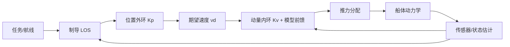
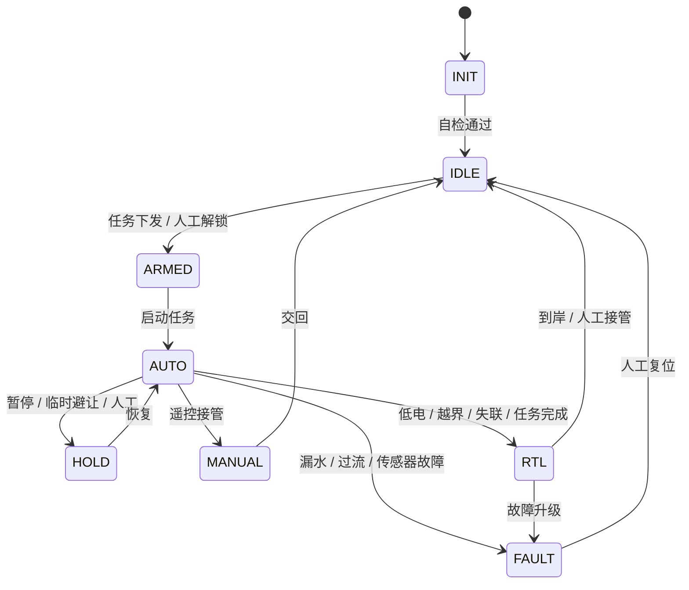

# 2. 定位、导航与矢量控制

本分册对应需求 2：以船舶的惯性动量矢量和位置定位为核心的控制算法。核心思路是把船体广义动量 `p = Mν` 作为被控量，外环控位置/航向，内环控速度/动量，并叠加模型前馈与环境扰动补偿，最终通过双推进器差速分配为推力。

## 2.1 坐标系与状态定义

| 坐标系 | 定义 | 用途 |
| --- | --- | --- |
| `{n}` NED | 原点为任务起点，x 轴指北、y 轴指东、z 轴向下 | 全局定位、航线、围栏 |
| `{b}` 船体 | 原点为船体中心，x 轴船首、y 轴右舷、z 轴向下 | 速度、推力、传感器安装 |
| `{p}` 路径 | 沿航线切向/法向 | 横向误差、LOS 制导 |

状态量：

- 位置/航向：`η = [x, y, ψ]ᵀ`，`ψ` 为真北顺时针航向角。
- 速度：`ν = [u, v, r]ᵀ`，分别为纵荡、横荡、艏摇角速度。
- 运动学：`η̇ = R(ψ)ν`，其中

$$
R(\psi)=\begin{bmatrix}\cos\psi & -\sin\psi & 0\\ \sin\psi & \cos\psi & 0\\ 0 & 0 & 1\end{bmatrix}
$$

## 2.2 多源融合定位

### 2.2.1 输入与频率

| 来源 | 观测 | 频率 | 用途 |
| --- | --- | --- | --- |
| RTK GPS | 经纬度、速度、定位质量、卫星数 | 5–10 Hz | 绝对位置/速度 |
| IMU | 比力、角速度 | 200–400 Hz | 预测、姿态、短时航位推算 |
| 磁罗盘 | 航向 | 50 Hz | 航向观测 |
| 双天线 RTK（可选） | 航向 | 5–10 Hz | 航向校验/替代罗盘 |
| 船体模型 | 速度约束（无侧滑） | 50 Hz | 约束横荡速度 |

### 2.2.2 EKF 状态与模型

状态向量取 9 维：

$$
\mathbf{x}=[x,\ y,\ \psi,\ u,\ v,\ r,\ b_{ax},\ b_{ay},\ b_{gz}]^{\mathsf T}
$$

其中 `b_a`、`b_g` 为加速度计/陀螺零偏。预测用 IMU 比力与角速度（转到 NED 后积分），观测用 GPS 位置/速度与罗盘航向。工程上可直接使用 ROS 2 `robot_localization` 的双 EKF 方案（`map→odom→base_link`），也可以自研 C++ 节点以精确控制模型与噪声：

- **预测**：`x_{k+1} = f(x_k, u_k) + w_k`，`u_k` 为 IMU 比力/角速度；过程噪声 `Q` 随速度与机动自适应。
- **更新**：GPS 位置/速度、罗盘航向分别更新；使用马氏距离门限剔除野值（如 GPS 跳点、磁干扰）。
- **约束**：低速时横荡速度 `v≈0` 作为伪观测，抑制侧滑漂移。
- **输出**：位置、速度、航向及协方差；协方差超阈值时降级自主等级。

### 2.2.3 RTK 降级策略

| 定位状态 | 判定 | 控制策略 | 数据标记 |
| --- | --- | --- | --- |
| RTK 固定解 | fix type 4，基线正常 | 正常自主，全速 | `fix=rtk_fixed` |
| RTK 浮点解 | fix type 5 | 限速 0.8 m/s，放宽航迹阈值 | `fix=rtk_float` |
| 单点 GPS | fix type 1/2 | 限速 0.6 m/s，仅保留人工监督下的简单航线 | `fix=gps` |
| GPS 丢失 < 60 s | 无有效定位 | 航位推算 + 罗盘保持航向，减速，尝试重捕 | `fix=dead_reckoning` |
| GPS 丢失 ≥ 60 s | 持续无定位 | 原地低速待命/顶风保持，告警，等待人工 | `fix=lost` |

> 定位丢失时不盲目"返航"，因为返航同样依赖位置；优先保持船位与姿态，等待 GPS 恢复或人工接管。

### 2.2.4 罗盘校准与倾斜补偿

1. **硬磁/软磁校准**：整船组装完成后，在开阔水域做水平旋转（8 字/整圈），采集各姿态磁数据，做椭球拟合求硬磁偏移与软磁矩阵。
2. **倾斜补偿**：使用 IMU 的横滚/俯仰把船体磁场旋转到水平面，再计算航向；公式为

$$
\begin{bmatrix} m_x' \\ m_y' \\ m_z' \end{bmatrix}
= R_x(\phi)R_y(\theta)\begin{bmatrix} m_x \\ m_y \\ m_z \end{bmatrix},\qquad
\psi_m=\operatorname{atan2}\left(-m_y',\ m_x'\right)
$$

3. **干扰检测**：比较磁场模长与校准值、比较内外罗盘航向、比较 RTK 航向；偏差超阈值时告警并降级。
4. **安装**：罗盘远离电机、电调和电池主线；动力线双绞，必要时加磁屏蔽罩。

### 2.2.5 时间同步

- GPS 提供 PPS + UTC，Jetson 用 `chrony`/`gpsd` 驯服系统时钟，误差 < 10 ms。
- 所有传感器数据打上采集时间戳；视频帧携带绝对时间（SEI 或 sidecar），便于事后对齐。
- 遥测、采样、告警统一用 UTC ISO 8601 存储，前端按本地时区展示。

### 2.2.6 初始化与航向对齐

- 上电后先完成 IMU 静止校准（约 2 s），再等待 GPS 定位。
- 航向初值优先级：双天线 RTK → 罗盘 → GPS 航迹角（需船舶运动）；静止时使用罗盘。
- 初始位置以第一次 RTK 固定解为准，原点写入任务上下文。

## 2.3 船舶动力学模型

### 2.3.1 三自由度模型

忽略横摇/纵摇/垂荡对平面运动的主影响，采用 3-DOF 模型：

$$
M\dot{\nu}+C(\nu)\nu+D(\nu)\nu=\tau+\tau_{env}
$$

- `M = M_RB + M_A`：刚体惯性 + 附加质量，近似对角：
  `M = diag(m - X_u̇, m - Y_v̇, I_z - N_ṙ)`。
- `C(ν)`：科里奥利/向心力矩阵，含 `m u r`、`m v r` 耦合项。
- `D(ν)`：阻尼，线性 + 二次项：
  `D = diag(X_u + X_|u|u|u|, Y_v + Y_|v|v|v|, N_r + N_|r|r|r|)`。
- `τ = [τ_u, τ_v, τ_r]ᵀ`：纵向推力、横向力（双推进器约为 0）、艏摇力矩。
- `τ_env`：风、浪、流的等效扰动力。

### 2.3.2 参数辨识

| 参数 | 辨识方法 | 备注 |
| --- | --- | --- |
| 推力-转速/指令曲线 | 系泊推力试验/厂家曲线 | 建立 `T(cmd)` 查表 |
| 纵向阻尼 `X_u`（线性）、`X_uu`（二次项） | 匀速直航试验，记录稳态推力与速度 | 多点拟合 |
| 横向阻尼 `Y_v` | 侧向拖曳/斜航试验 | 可用经验值初估 |
| 艏摇阻尼 `N_r`（线性）、`N_rr`（二次项） | 螺旋/zigzag 试验 | 记录 `r(t)` 与 `τ_r` |
| 附加质量 | 经验公式/CFD | 初步按刚体质量的 10%–30% 估算 |
| 风阻/流 | 风洞/现场对比 | 作为扰动观测器输入 |

> 表中 `X_uu`、`N_rr` 分别表示 `|u|u`、`|r|r` 二次阻尼项。

原型阶段可先用经验值 + 水池试验整定，湖试阶段用最小二乘/递推最小二乘细化。

## 2.4 惯性动量矢量 + 位置控制

### 2.4.1 控制思想

定义船体广义惯性动量矢量：

$$
p=M\nu=\begin{bmatrix}(m-X_{\dot u})u\\ (m-Y_{\dot v})v\\ (I_z-N_{\dot r})r\end{bmatrix}
$$

把 `p` 作为内环被控量，把位置/航向误差作为外环，形成"位置外环 → 期望速度/动量 → 动量内环 → 推力分配"的级联结构。相比纯 PID，显式引入 `Mν̇`、`C(ν)ν`、`D(ν)ν` 前馈，可在加减速、转弯和风浪流中显著减小跟踪滞后。



### 2.4.2 控制律

设期望位置/航向 `η_d`、期望速度 `η̇_d` 由制导给出，误差：

$$
e_\eta=\eta_d-\eta,\qquad e_\nu=\nu_d-\nu
$$

期望速度（外环，位置误差转速度指令）：

$$
\nu_d=R^{\mathsf T}(\psi)\left(\dot\eta_d+\Lambda e_\eta\right)
$$

控制力矩（内环，动量/速度跟踪 + 位置刚度）：

$$
\tau=M\dot\nu_d+C(\nu)\nu+D(\nu)\nu+K_v e_\nu+R^{\mathsf T}(\psi)K_\eta e_\eta
$$

代入动力学可得简化误差方程（忽略 `Ṙ` 与高阶耦合项）：

$$
M\dot e_\nu=-K_v e_\nu-R^{\mathsf T}K_\eta e_\eta
$$

取 Lyapunov 函数 `V = ½ e_νᵀ M e_ν + ½ e_ηᵀ K_η e_η`（在航向误差较小时近似成立），`Λ, K_η, K_v` 正定时局部收敛。实际实现中：

- `Λ` 为位置/航向到速度的增益（单位 1/s），`K_η` 为位置/航向到力的刚度（单位 N/m），`K_v` 为速度/角速度增益。
- `ν̇_d` 用数值微分 + 低通滤波获得，避免噪声放大。
- 当 `|e_η|` 较大时限幅 `ν_d`，防止大角度转向时速度指令突变。
- 积分项用于补偿常值流/风：`τ_i = K_i ∫e_ν dt`，带抗饱和。

### 2.4.3 推力分配

双推进器左右对称安装，间距 `2b`（`b` 为单侧力臂）。令左右推力为 `T_L, T_R`：

$$
\tau_u=T_L+T_R,\qquad \tau_r=b\,(T_R-T_L)
$$

反解：

$$
T_L=\frac{1}{2}\left(\tau_u-\frac{\tau_r}{b}\right),\qquad
T_R=\frac{1}{2}\left(\tau_u+\frac{\tau_r}{b}\right)
$$

工程处理：

- **饱和**：`|T_L|,|T_R| ≤ T_max`；超限时按比例缩放，优先保留艏摇力矩（转向优先）。
- **死区**：`|T| < 0.03 T_max` 置零，避免电机频繁启停。
- **非线性映射**：推进器推力与指令呈二次关系，使用厂家曲线或标定查表 `T = f(cmd)`，反解 `cmd = f⁻¹(T)`。
- **倒车**：反向推力效率较低，倒车时限制最大推力并降低速度指令。
- **横向力**：双推进器不产生横向力，`τ_v≈0`；横荡靠航向机动与位置外环间接控制。

### 2.4.4 离散实现（50 Hz）

```python
import numpy as np


def wrap_pi(a):
    return (a + np.pi) % (2 * np.pi) - np.pi


class MomentumController:
    """惯性动量矢量 + 位置控制（50 Hz 离散实现示意）。"""

    def __init__(self, M, b, t_max, lam, kv, keta, ki, dt):
        self.M, self.b, self.t_max = M, b, t_max
        self.lam = np.diag(lam)         # 位置/航向 -> 速度 [1/s]
        self.kv = np.diag(kv)           # 速度/角速度增益
        self.keta = np.diag(keta)       # 位置/航向 -> 力 [N/m]
        self.ki = np.diag(ki)           # 积分增益
        self.dt = dt
        self.integ = np.zeros(3)
        self.nu_d_prev = np.zeros(3)
        self.nu_d_dot_f = np.zeros(3)   # 期望加速度低通状态

    def step(self, eta, nu, eta_d, eta_dot_d):
        e_eta = eta_d - eta
        e_eta[2] = wrap_pi(e_eta[2])

        c, s = np.cos(eta[2]), np.sin(eta[2])
        R = np.array([[c, -s, 0.0], [s, c, 0.0], [0.0, 0.0, 1.0]])

        nu_d = R.T @ (eta_dot_d + self.lam @ e_eta)
        nu_d = np.clip(nu_d, [-1.0, -0.3, -1.2], [2.0, 0.3, 1.2])
        e_nu = nu_d - nu

        # 期望加速度：数值微分 + 一阶低通
        alpha = 0.2
        raw = (nu_d - self.nu_d_prev) / self.dt
        self.nu_d_dot_f = (1 - alpha) * self.nu_d_dot_f + alpha * raw
        self.nu_d_prev = nu_d

        # 模型前馈 + 反馈；C(nu)、D(nu) 返回 3x3 矩阵
        tau = (self.M @ self.nu_d_dot_f
               + self.C(nu) @ nu
               + self.D(nu) @ nu
               + self.kv @ e_nu
               + R.T @ self.keta @ e_eta
               + self.ki @ self.integ)
        tau = self._limit_tau(tau)

        cmd_l, cmd_r, saturated = self._allocate(tau)
        if not saturated:
            self.integ = np.clip(self.integ + e_nu * self.dt, -0.5, 0.5)
        return cmd_l, cmd_r

    def _limit_tau(self, tau):
        tau = np.array(tau, dtype=float)
        tau[0] = np.clip(tau[0], -2 * self.t_max, 2 * self.t_max)
        tau[2] = np.clip(tau[2], -2 * self.b * self.t_max, 2 * self.b * self.t_max)
        return tau

    def _allocate(self, tau):
        tl = 0.5 * (tau[0] - tau[2] / self.b)
        tr = 0.5 * (tau[0] + tau[2] / self.b)
        scale = max(abs(tl), abs(tr)) / self.t_max
        saturated = scale > 1.0
        if saturated:
            tl, tr = tl / scale, tr / scale
        return self.thrust_to_cmd(tl), self.thrust_to_cmd(tr), saturated
```

> `C(nu)`、`D(nu)` 按 2.3 节辨识模型实现，`thrust_to_cmd` 按台架标定曲线实现；示例省略了参数合法性检查、模式管理与故障处理，不能直接作为飞行代码使用。


### 2.4.5 抗扰与自适应

- **积分补偿**：常值风/流引起的稳态误差由积分项消除，积分限幅并做条件积分（饱和时停止积分）。
- **扰动观测器**：由 `τ` 与 `ν̇` 反算等效力 `τ̂_env`，前馈补偿；对波浪做带通滤波，避免把高频运动当成常值流。
- **增益调度**：低速时减小 `K_v` 防止抖动，高速时增大阻尼；转弯时降低速度上限。
- **参数慢变**：电池电压、载荷变化导致推力效率变化，用推力标定表 + 在线估计修正。

### 2.4.6 与飞控的接口方式

| 方式 | 数据流 | 优点 | 缺点 | 适用 |
| --- | --- | --- | --- | --- |
| A. 速度/位置指令 | Jetson → MAVROS → ArduPilot 内部控制器 | 飞控兜底强，安全 | 难以实现自定义动量控制 | 产品化首选 |
| B. 推力直控 | Jetson 计算 `T_L/T_R` → `MANUAL_CONTROL`/执行器指令 | 可完整实现本方案控制律 | 依赖 Jetson 存活，需严格看门狗 | 算法验证/研究 |

本方案建议：**日常巡逻用方式 A**（飞控内部速度/位置控制，Jetson 只发期望速度），**算法验证与性能测试用方式 B**（Jetson 跑动量控制器，飞控做增稳与安全兜底）。两种方式共用同一套制导与安全状态机，通过参数切换。

## 2.5 制导与路径跟踪

### 2.5.1 LOS 视线制导

对航线段 `P_k→P_{k+1}`，令单位切向 `t`、左法向 `n=(-t_y, t_x)`，横向误差 `e=(p-P_k)·n`，前视距离 `Δ`：

$$
\psi_{los}=\psi_{path}-\operatorname{atan2}(e,\Delta)
$$

其中 `ψ_path = atan2(Δy, Δx)`。`Δ` 随速度自适应：`Δ = clamp(3 + 2|u|, 3, 8)` m。横向误差大时增大 `Δ` 以平滑回归，接近航线时减小 `Δ` 提高精度。

### 2.5.2 航点切换与转弯

- **到达判定**：进入半径 `R_accept = 2 m`，且沿航向投影已越过航点，才切换到下一段，避免切角。
- **转弯预判**：根据当前速度与最大转艏角速度计算转弯半径，提前 `R_turn` 减速；大转角（>60°）降到 0.6 m/s。
- **原地转向**：定点采样时可用差速原地转向（`T_L=-T_R`），将航向对准下一点后再加速。

### 2.5.3 速度规划

- 任务速度 `v_mission` 默认 1.2 m/s，可分段配置。
- 终点/采样点前按梯形速度曲线减速：`v ≤ sqrt(2 a d_remain)`，`a≈0.3 m/s²`。
- 曲率限制：`v ≤ sqrt(a_lat / κ)`，`a_lat≈0.4 m/s²`。
- 风浪流大时自动降速 20%–40%，并增大航迹容差。

### 2.5.4 定点保持与原地转向

- 定点保持：位置外环 + 积分，速度指令限幅 0.3 m/s；误差 < 2 m 时只做小推力修正。
- 原地转向：航向误差 → 差速推力，速度前馈为 0；转向角速度限幅 30°/s。
- 采样作业：先减速到 0.2 m/s，稳定 10 s 后再采样，减少船体晃动对水质探头的影响。

## 2.6 安全控制与失效保护

### 2.6.1 状态机



### 2.6.2 触发条件

| 事件 | 判定 | 动作 | 恢复 |
| --- | --- | --- | --- |
| 遥控丢失 | 2 s 无 RC | HOLD 5 s，仍无则 RTL | 遥控恢复/人工 |
| 云端失联 | 30 s 无心跳 | 继续任务，本地缓存 | 自动重连 |
| 云端失联 > 10 min | 心跳持续丢失 | 完成任务后 RTL | 自动 |
| GPS 丢失 | 60 s 无有效定位 | 减速、保持航向、低速待命（可能随流漂移）并告警 | GPS 恢复/人工 |
| RTK 降级 | fix < 4 | 限速，标记数据 | 恢复固定解 |
| 低电一级 | 24.0 V | 告警，停止新任务 | 充电 |
| 低电二级 | 23.2 V | RTL | 充电 |
| 低电三级 | 22.4 V | 停船，保留通信 | 人工 |
| 越界 | 预测 10 s 位置出围栏 | 减速 + RTL | 人工复位 |
| 漏水 | 舱内电极触发 | 告警 + RTL；严重时停船 | 人工 |
| 过流/过温 | 推进/电池超限 | 降额/停推 | 冷却/复位 |
| 急停 | 实体按钮 | 切断推进，保留通信与灯光 | 人工复位 |
| Jetson 失联 | 飞控 2 s 无心跳 | RTL/HOLD（可配） | 重启/人工 |

### 2.6.3 电子围栏

- 围栏为多边形（库区边界 + 禁航区），外扩 5 m 安全缓冲。
- 每秒检查当前位置与 10 s 预测位置；预测越界立即减速并转向。
- 围栏与返航点均支持平台远程更新，更新前校验多边形合法性（无自交、面积/顶点数限制）。
- 围栏内再设"低速区"（取水口、坝前、网箱区），进入自动限速 0.5 m/s。

### 2.6.4 避障与安全优先级

优先级从高到低：

1. 急停/硬件保护；
2. 电子围栏与低电返航；
3. 视觉/近距传感器紧急停船；
4. 避障绕行；
5. 航线跟踪；
6. 任务速度优化。

避障指令只能"减速/停船/有限绕行"，不得把船推向围栏外或浅水区；当避障与围栏冲突时，选择停船并告警。

### 2.6.5 急停与回收

- 实体急停切断推进动力，保留飞控、通信、灯光和定位，便于打捞。
- 船体配落水浮标/反光标识；失控漂移时平台显示最后位置并告警。
- 救援预案：安全员、救援船、打捞钩、备用电池。

## 2.7 参数初值与整定

| 参数 | 初值 | 说明 |
| --- | --- | --- |
| 控制频率 | 50 Hz | 飞控/动量控制器 |
| EKF 频率 | 100 Hz | 预测 100 Hz，观测按传感器 |
| `Λ` 位置→速度 | `diag(0.6, 0.6, 1.0)` | 1/s，先小后大 |
| `K_η` 位置→力 | `diag(20, 20, 10)` | N/m，按质量/惯量缩放 |
| `K_v` 速度 | `diag(40, 40, 8)` | 按质量/惯量缩放 |
| `K_i` 积分 | `diag(0.5, 0.5, 0.2)` | 抗常值流 |
| LOS 前视 `Δ` | 3–8 m | 随速度自适应 |
| 到达半径 | 2 m | 采样点可减小到 1 m |
| 巡航速度 | 1.2 m/s | 可分段配置 |
| 最大转艏角速度 | 30°/s | 避免甩尾 |
| 推力死区 | 3% | 防止电机频繁启停 |

**整定流程**：

1. 台架标定推力-指令曲线，记录死区、正反向效率。
2. 水池直航阶跃：调整 `K_v` 使速度响应无超调、无稳态误差。
3. 水池定点/直线：调整 `K_p` 与 LOS 前视，记录 RMSE。
4. 水池 Z 形/回转：辨识 `N_r`、`N_|r|r`，调整航向增益。
5. 湖试风浪流：加积分/扰动观测器，验证 4 级风下航迹 ≤2 m。
6. 每次修改参数记录版本与测试数据，支持一键回滚。

## 2.8 控制性能验收

| 测试 | 条件 | 通过标准 |
| --- | --- | --- |
| 直线跟踪 | 静水，100 m | 横向 RMSE ≤ 0.8 m，最大偏差 ≤ 1.2 m |
| 定点保持 | 静水，10 min | 半径 ≤ 1.5 m |
| 定点保持 | 3 级风 | 半径 ≤ 2.5 m |
| 航向阶跃 | 90° 转向 | 超调 ≤ 10%，调节时间 ≤ 8 s |
| 速度阶跃 | 0→1.2 m/s | 上升时间 ≤ 5 s，超调 ≤ 10% |
| 低电返航 | 模拟 23.2 V | 100% 触发并安全返航 |
| 失联返航 | 关闭遥控/4G | 按策略触发，返航轨迹可回放 |
| 围栏 | 预测越界 | 提前减速，不越界 |
