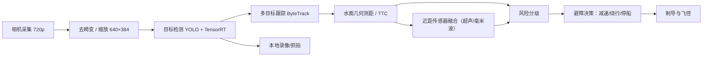

# 3. 视觉避障与水深/水质感知

本分册对应需求 3 和需求 4：简单、可靠的视觉避障，以及水深、水质传感器的接入与数据处理。设计取向是"轻量模型 + 几何测距 + 规则决策 + 传感器兜底"，不追求全场景自动驾驶，重点是可解释、可验证、可降级。

## 3.1 视觉避障

### 3.1.1 需求与边界

| 项目 | 目标 |
| --- | --- |
| 检测目标 | 船只、浮标、漂浮物/垃圾、渔网、人员、岸线/礁石 |
| 作用距离 | 漂浮物（≥0.3 m）≥15 m；船只 ≥40 m（白天、能见度良好） |
| 处理帧率 | ≥20 FPS（720p 输入） |
| 响应时间 | 从目标入画到控制响应 ≤500 ms |
| 适用条件 | 白天、无强雨雾；夜间/强逆光不开启自主避障 |
| 安全边界 | 只做减速/停船/有限绕行，不替代人工瞭望与雷达 |

**明确不做**：不做全自主靠泊、不做复杂水道全自动驾驶、不依赖视觉做唯一避障手段。视觉失效时由近距传感器、限速和人工接管兜底。

### 3.1.2 相机、安装与标定

| 项目 | 参数 |
| --- | --- |
| 分辨率/帧率 | 1920×1080 @30，避障用 1280×720 或 640×384 |
| 视场角 | 水平 ≥90°，垂直 ≥50° |
| 安装高度 | 水线以上约 0.6 m |
| 俯仰角 | 向下约 5°（可调） |
| 快门 | 优先全局快门，减少横摇拖影 |
| 防护 | IP67 罩 + 光学窗 + 防雾加热/干燥剂 |

标定内容：

1. **内参**：焦距 `f_x, f_y`、主点 `c_x, c_y`、畸变系数，棋盘格标定，结果写入船端参数文件。
2. **外参**：相机相对船体中心的安装位置与姿态，用于把障碍物变换到船体坐标系。
3. **地平线标定**：在静水、已知俯仰角下记录地平线像素行 `y_h`；航行中根据 IMU 横滚/俯仰修正。
4. **水线复核**：在已知距离放置浮标，核对测距误差，修正安装高度与俯仰。

### 3.1.3 处理流水线



### 3.1.4 障碍检测

- 模型：YOLOv8n / YOLO11n 级别的轻量检测器，输入 640×384，TensorRT INT8 部署。
- 类别：`boat`、`buoy`、`debris`、`person`、`net`、`shore`（可按库区实际裁剪）。
- 训练数据：现场采集 + 公开水面数据集，目标 5,000–10,000 张标注图；包含逆光、波纹、倒影、雨雾、夜间等困难负样本。
- 指标：验证集 mAP@0.5 ≥ 0.75；重点类别召回 ≥ 0.90；量化后精度下降 ≤ 3%。
- 后处理：置信度阈值 0.35（可调），NMS IoU 0.45；小目标（<32×32 像素）降低权重并标记低置信。

### 3.1.5 单目测距与 TTC

**水面几何测距**（假设目标底部与水面接触）：

$$
d=\frac{f_y\cdot H}{y_b-y_h}
$$

- `H`：相机光心到水面的高度（约 0.6 m，随吃水变化）；
- `f_y`：垂直方向焦距（像素）；
- `y_b`：目标检测框底边（水线接触点）像素行；
- `y_h`：地平线像素行（俯仰向下为正），按 IMU 俯仰修正：

$$
y_h=c_y-f_y\tan\theta_{pitch}
$$

横滚会使地平线倾斜，可按 IMU 横滚旋转坐标系后再计算；小角度下可忽略。

**TTC（碰撞时间）**：

$$
TTC=\frac{d}{-\dot d}\approx\frac{h_{box}}{\dot h_{box}}
$$

- 由连续帧距离差分估计 `ḋ`，或由检测框高度增长率估计；
- 对 `ḋ ≥ 0`（远离）置为无穷大；
- 距离/ TTC 做 5 帧中值滤波，避免抖动。

**误差与置信**：

| 误差源 | 影响 | 处理 |
| --- | --- | --- |
| 目标底部不接触水面（如船体） | 距离偏大 | 用目标类别先验高度/吃水修正，或降级为"近距" |
| 波浪/船体横摇 | 地平线抖动 | IMU 补偿 + 中值滤波 |
| 相机俯仰安装误差 | 系统性偏差 | 标定 + 已知距离复核 |
| 小目标/低对比度 | 检测不稳定 | 连续帧确认 + 置信度阈值 |

测距结果带置信度；置信度低时只用于"近距告警"，不参与精确避让。

### 3.1.6 避障决策

按"距离 + 方位 + TTC"划分风险等级：

| 等级 | 条件（示例） | 动作 |
| --- | --- | --- |
| 安全 | `d > 15 m` 或目标在航道外 | 正常航行 |
| 注意 | `8 m < d ≤ 15 m`，方位在 ±30° | 降速至 0.8 m/s，持续跟踪 |
| 危险 | `4 m < d ≤ 8 m` 或 `TTC < 6 s` | 降速至 0.5 m/s，选择绕行航向 |
| 紧急 | `d ≤ 4 m` 或 `TTC < 3 s` | 停船/倒车，告警 |
| 失效 | 相机/模型超时、置信度持续低 | 降速、近距传感器接管、必要时 RTL |

**简化决策规则**（默认启用，可解释、易调试）：

1. 计算障碍物在船体坐标系的方位 `β` 与距离 `d`。
2. 若 `|β| > 45°` 或 `d > 15 m`，不干预。
3. 若 `|β| ≤ 45°` 且 `d ≤ 15 m`：按 `d` 分级减速。
4. 若 `d ≤ 8 m`：比较左右两侧可用空间，向空间更大的一侧偏转 20°–40°；偏转后仍需满足围栏与水深约束。
5. 若 `d ≤ 4 m` 或 `TTC < 3 s`：停船；障碍物移开后自动恢复（需连续 2 s 无风险）。
6. 若左右均无空间（狭窄水道/岸边）：停船并告警，等待人工。

**候选航向代价**（可选增强，仍属轻量规则）：

$$
J(\psi_c)=w_1|\psi_c-\psi_{path}|+w_2\sum_i \max(0,\ R_{safe}-d_i(\psi_c))+w_3\,\mathbb{1}[\text{出围栏}]
$$

在 `ψ_path + {-60°,-40°,-20°,0°,20°,40°,60°}` 中选 `J` 最小且满足围栏/水深约束的航向。`R_safe` 取 5 m，权重按现场调试。

### 3.1.7 与制导、安全系统的集成

- 避障输出两个量：`Δψ`（航向偏置）与 `k_v`（速度缩放 0–1），叠加到制导指令上，不直接改航点。
- 制导层对 `Δψ` 限幅 ±60°，对 `k_v` 限幅 0–1；避障不能突破围栏、浅水告警和急停。
- 响应链路：相机 33 ms + 推理 15–30 ms + 决策 5 ms + 控制 20 ms，总延迟 <100 ms；从入画到执行 <300 ms。
- 所有避障事件记录：时间、目标类别、距离、方位、动作、视频片段，便于复盘。

### 3.1.8 数据集与训练流程

1. 现场采集：不同时段、天气、光照、船速、目标类型；至少覆盖 3 个季节/水位。
2. 标注：矩形框 + 类别；难例单独标记（倒影、浪花、鸟、雨滴）。
3. 训练：YOLO 官方流程，80/10/10 划分；数据增强（亮度、对比度、模糊、雨雾、裁剪）。
4. 量化：TensorRT INT8，校准集 500–1,000 张；对比 FP16/INT8 精度与速度。
5. 部署：ONNX → TensorRT engine，船端加载；模型版本与训练数据版本绑定。
6. 回归：新模型先在离线视频集回放，再上船限速测试，最后全速。

### 3.1.9 失效降级

- 相机遮挡/黑屏/帧率过低：立即降速，切换近距传感器，告警。
- 强逆光/日落：降低自主等级，限制速度 ≤0.6 m/s，必要时 RTL。
- 雨雾/夜间：关闭自主避障，仅保留近距超声/毫米波，人工遥控。
- 模型输出异常（全屏误检/漏检）：连续 N 帧统计异常，降级并记录。

### 3.1.10 视觉验收指标

| 指标 | 目标 |
| --- | --- |
| 检测召回（5–30 m，白天） | ≥ 95%（重点类别） |
| 误检率 | ≤ 5% |
| 测距误差（5–20 m） | ≤ 15% 或 ≤ 2 m（取较大者） |
| 处理帧率 | ≥ 20 FPS |
| 避障响应 | ≤ 500 ms |
| 误撞 | 0（测试场景） |

## 3.2 水深测量

### 3.2.1 原理与选型

单波束测深仪发射 200 kHz 声波，接收水底回波，按声速与往返时间计算水深：

$$
d=\frac{c\cdot t}{2}
$$

| 项目 | 参数 |
| --- | --- |
| 频率 | 200 kHz（淡水、浅水适用） |
| 量程 | 0.3–100 m |
| 精度 | ±1% ±0.1 m（典型） |
| 波束角 | 8°–12° |
| 输出 | NMEA 0183 DBT/DPT，RS232，4800/9600 |
| 更新率 | 5 Hz |

### 3.2.2 安装

- 换能器安装在船底最低点，声束垂直向下，远离推进器尾流与气泡。
- 加导流罩，避免航行中产生气泡；换能器表面涂防污漆（不影响声学）。
- 记录换能器吃水 `draft`（换能器面到水线的距离）与安装坐标，用于修正。

### 3.2.3 姿态、吃水与声速修正

1. **吃水修正**：`d_surface = d_measured + draft`。
2. **姿态修正**：船体横摇/纵摇使声束偏离垂直，斜距 `d` 对应垂直深度近似：

$$
d_{vertical}=d\cdot\cos\phi\cdot\cos\theta
$$

其中 `φ` 为横滚、`θ` 为俯仰；角度由 IMU 提供。

3. **声速修正**：测深仪通常按 1500 m/s 计算；实际淡水声速约 1450–1490 m/s，按温度/盐度修正：

$$
d_{corrected}=d_{measured}\cdot\frac{c_{actual}}{c_{assumed}}
$$

4. **水位修正**：水库水位随季节变化，绝对河床高程 `z_bed = z_water - d_surface`；水位来自库区水位站或人工输入。
5. **滤波**：5 点中值 + 限幅（相邻点变化 >20% 视为野值），保留原始值与修正值。

### 3.2.4 数据格式与处理

- 解析 NMEA `DBT`（深度、单位）或 `DPT`（深度、偏移）；同时记录原始语句。
- 每条测深记录：时间、经纬度、原始深度、修正深度、姿态、水温、定位质量、质量标记。
- 浅水告警：`d_surface < 1.0 m` 时降速，`<0.6 m` 时停船/绕行。
- 成果：沿程水深曲线、断面图、网格插值水深图（IDW/克里金）。

### 3.2.5 测深验收

| 项目 | 标准 |
| --- | --- |
| 量程 | 0.5–50 m 实用（按选型） |
| 比对误差 | ±1% ±0.1 m |
| 数据完整率 | ≥ 98%（有效定位段） |
| 浅水告警 | 100% 触发 |

## 3.3 水质采集

### 3.3.1 参数与选型

| 参数 | 量程 | 精度 | 原理 | 备注 |
| --- | --- | --- | --- | --- |
| pH | 0–14 | ±0.1 | 玻璃电极 | 需定期校准 |
| 溶解氧 DO | 0–20 mg/L | ±0.2 mg/L | 荧光法/原电池 | 荧光法维护量低 |
| 浊度 | 0–1000 NTU | ±5% 或 ±0.3 NTU | 90° 散射 | 防气泡 |
| 电导率 | 0–200 mS/cm | ±1% | 四电极 | 可换算盐度/TDS |
| 水温 | −5–60 ℃ | ±0.2 ℃ | NTC | 所有参数的补偿基准 |
| 氨氮（可选） | 0–100 mg/L | ±5% | 离子选择 | 需试剂/维护 |
| 叶绿素/蓝绿藻（可选） | 0–500 µg/L | ±5% | 荧光 | 藻华预警 |

### 3.3.2 采样方式

**推荐：流通池 + 微型泵**

- 进水口位于船底/舷侧，离推进器 ≥0.5 m，进水深度约 0.3 m。
- 泵流量 1–2 L/min，先冲洗 30–60 s 再读数，减少管路残留。
- 流通池避免气泡；探头敏感面朝下/侧向，防止气泡附着。
- 采样点停船或低速（≤0.3 m/s），稳定 10 s 后连续读 3 次取中值。

**备选：直接浸没**

- 结构简单、成本低，但易受船体晃动、气泡和生物附着影响；适合低频次抽检。

### 3.3.3 Modbus RTU 读取

- 物理层：RS485，9600/19200 8N1，半双工；终端电阻 120 Ω。
- 协议：Modbus RTU，功能码 0x03（读保持寄存器），探头地址 1–247。
- 典型流程：

```text
请求: 01 03 00 00 00 0A C5 CD   # 从站1，读10个寄存器
响应: 01 03 14 [20字节数据] [CRC]
```

- 实现要点：
  - 按探头手册解析寄存器（浮点/整型、字节序、缩放系数）。
  - 超时 300 ms，失败重试 3 次；连续失败标记传感器故障。
  - 读取周期 1 Hz；采样任务时提高优先级。
  - 所有原始帧写入日志，便于排查。

### 3.3.4 校准、清洗与维护

| 项目 | 周期 | 方法 |
| --- | --- | --- |
| pH | 每 2 周/每次投放 | 4.01/7.00/10.01 三点校准 |
| DO | 每 2 周 | 零氧/饱和空气校准 |
| 浊度 | 每月 | 福尔马肼标准液 |
| 电导率 | 每月 | KCl 标准液 |
| 温度 | 每季度 | 比对温度计 |
| 探头清洗 | 每次任务后 | 软布/稀盐酸（按厂家） |
| 防生物附着 | 持续 | 可拆卸滤网、紫外/机械刮刷；铜网仅用于非重金属监测场景 |

- 记录校准时间、标准液批次、校准斜率/截距；校准过期自动标记数据为"可疑"。
- 长期不用时按厂家要求保湿/保护电极，避免干涸。

### 3.3.5 数据质量

每条水质记录带质量标记：

| 标记 | 含义 | 触发示例 |
| --- | --- | --- |
| `GOOD` | 正常 | 在量程内、校准有效、波动正常 |
| `SUSPECT` | 可疑 | 超量程、校准过期、变化率异常、气泡 |
| `BAD` | 无效 | 通信失败、探头故障、维护中 |
| `ESTIMATED` | 估算 | 由相邻点插值/模型补全 |

质量控制规则：

- 量程检查、变化率检查（如 pH 1 s 内变化 >1 视为异常）。
- 三取中值；连续 3 次异常触发告警。
- 与历史同点位/同季节数据比对，偏离 >3σ 标记可疑。
- 水质数据与采样位置、深度、时间绑定，支持按点位/时间/参数导出。

## 3.4 多传感器时间同步与坐标统一

- 所有传感器数据使用统一 UTC 时间戳；GPS PPS 驯服系统时钟。
- ROS 2 `tf2` 维护 `map → odom → base_link → camera/depth/water_quality` 变换。
- 测深/水质记录使用采样时刻的插值位置（GPS 10 Hz，50 ms 内插值）。
- 相机帧携带时间戳与对应位姿，用于视频与轨迹对齐、事后取证。
- 时间偏差 >100 ms 的数据标记异常，不参与成果计算。

## 3.5 感知验收

| 项目 | 方法 | 标准 |
| --- | --- | --- |
| 视觉检测 | 离线视频集 + 现场 | 召回 ≥95%，误检 ≤5% |
| 视觉测距 | 已知距离浮标 | 5–20 m 误差 ≤15% 或 ≤2 m |
| 避障 | 水池/湖试布置障碍 | 不碰撞，响应 ≤500 ms |
| 测深 | 人工测深比对 | ±1% ±0.1 m |
| 水质 | 实验室比对 | 满足探头标称精度 |
| 数据完整性 | 连续 2 h 任务 | 有效数据 ≥98% |
