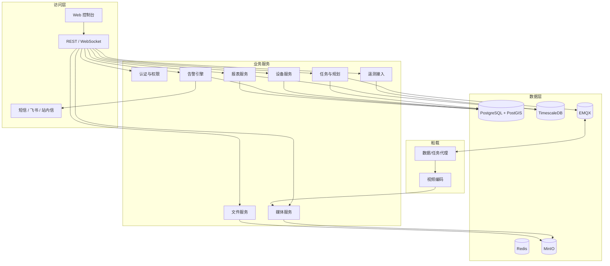
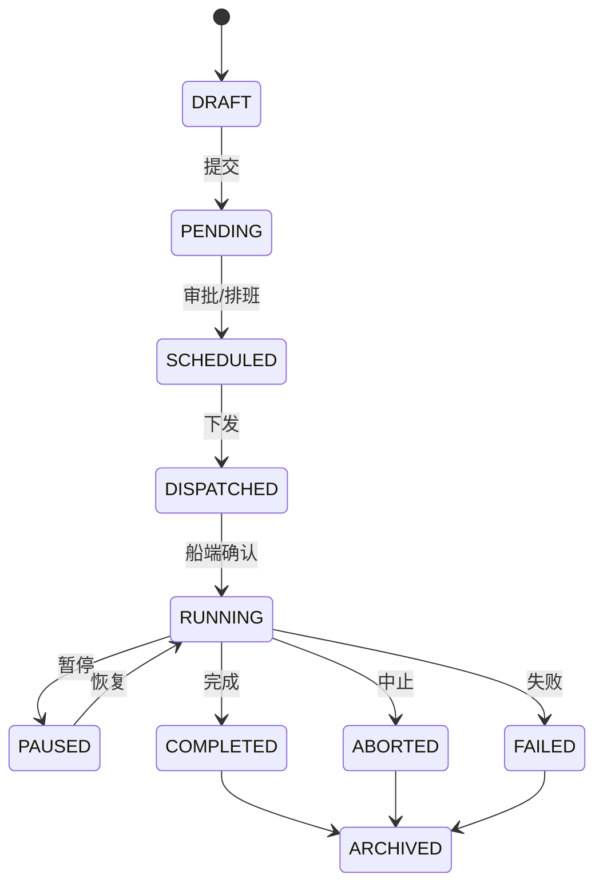
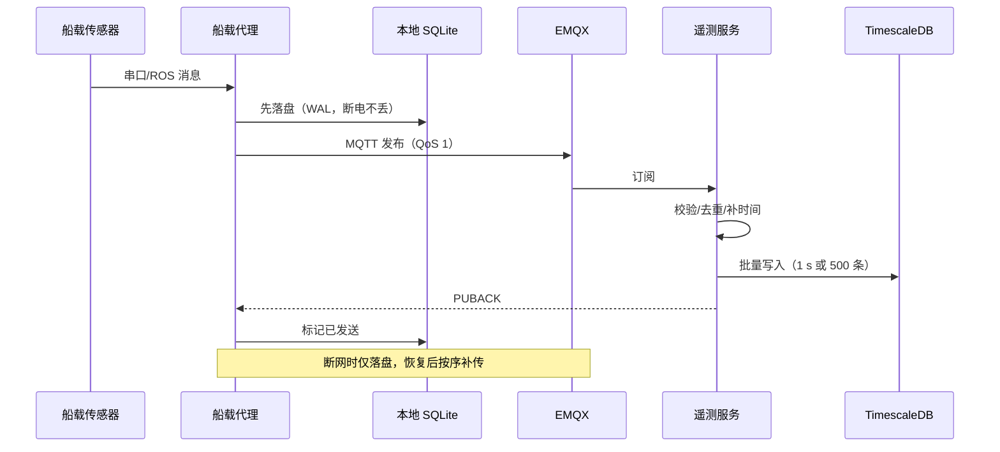
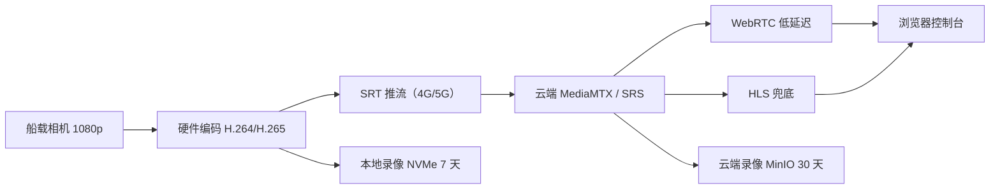

# 4. 后台巡逻、数据管理与控制台

本分册对应需求 5 和需求 6：后台任务自动巡逻规划管理系统、实时数据记录管理系统，以及控制台实时视频。平台按"任务规划—下发执行—数据回传—存储分析—告警报表—视频监视"的闭环设计。

## 4.1 平台总体



## 4.2 自动巡逻规划

### 4.2.1 区域与约束建模

| 对象 | 数据类型 | 说明 |
| --- | --- | --- |
| 作业区域 | GeoJSON Polygon | 库区可航行水域边界 |
| 禁航区 | Polygon | 取水口、坝前、泄洪区、养殖区 |
| 浅水区 | Polygon / 等深线 | 由历史测深生成，低于安全吃水 |
| 航线 | LineString + 航点 | 规划输出 |
| 采样点 | Point + 动作 | 水质/测深/拍照 |
| 返航点 | Point | 码头/充电坞 |
| 安全缓冲 | 距离 | 默认 5 m，按船宽与定位精度调整 |

坐标统一使用 WGS84，距离计算投影到当地 UTM 或使用测地线；规划结果回写 WGS84。

### 4.2.2 覆盖规划算法

默认采用**牛耕式（boustrophedon）**：将作业区域按扫描线切分，往返平行航线覆盖，适合水库这种大面积、形状不规则但连通的水域。

1. **主方向选择**：枚举 0°–180°（步长 15°），选择使扫描线总长度/转弯次数最少的方向；也可按库区主风向/主流向选择，减少横风航行。
2. **扫描线生成**：线间距 `s` 按任务类型确定：
   - 视频巡查：`s = 20–30 m`（相机有效观察宽度）；
   - 测深：`s = 10–20 m`（按成图比例尺）；
   - 水质：`s = 50–100 m` 或按采样点网格。
3. **多边形裁剪**：扫描线与区域多边形求交，遇岛屿/禁航区自动断成多段。
4. **连接**：相邻扫描段按最近端点连接；连接线需避开禁航区，必要时用可见图/最短路绕行。
5. **航点简化**：Douglas-Peucker 简化，保留转弯点、采样点和进出禁航区点。
6. **校验**：所有线段在区域内、不与禁航区相交、转弯半径满足要求、总里程/能耗在预算内。

```python
from shapely.geometry import Polygon, LineString, MultiLineString, Point
from shapely.ops import unary_union

def boustrophedon(area: Polygon, no_go: MultiLineString | None,
                  spacing: float, angle: float = 0.0) -> list[LineString]:
    """返回按扫描顺序排列的覆盖航线（简化示意）。"""
    area = rotate(area, -angle)
    minx, miny, maxx, maxy = area.bounds
    lines, y, flip = [], miny + spacing / 2, False
    while y < maxy:
        scan = LineString([(minx - 1, y), (maxx + 1, y)])
        for seg in split_lines(scan.intersection(area)):
            if no_go is not None and seg.intersects(no_go):
                seg = seg.difference(no_go.buffer(5.0))
            for part in split_lines(seg):
                if part.length < 2.0:
                    continue
                lines.append(reverse(part) if flip else part)
        y += spacing
        flip = not flip
    lines = rotate_geometry(lines, angle)
    return connect_nearest(lines)   # 最近端点连接，避开禁航区
```

> 生产实现建议使用 `shapely` + 自写连接逻辑，或在 QGIS/PostGIS 中预生成；复杂库区可引入 `pyvisgraph` 做可见图最短路。

### 4.2.3 采样点与动作

| 动作 | 触发 | 参数 | 说明 |
| --- | --- | --- | --- |
| `PHOTO` | 到达航点 | 数量、间隔 | 拍照并上传 |
| `WATER_SAMPLE` | 到达采样点 | 冲洗时间、读数次数 | 停船/低速，泵冲洗后读 3 次 |
| `DEPTH_LOG` | 沿航线连续 | 频率 | 5 Hz 记录 |
| `HOLD` | 到达航点 | 时长 | 悬停观察/等待指令 |
| `RTL` | 任务结束/异常 | — | 返航 |
| `GOTO` | 手动指定 | 目标点 | 应急前往 |

采样点布设：按网格（如 100 m×100 m）或沿等深线/岸线布设；支持导入历史点位，保证同比可追溯。

### 4.2.4 能耗与安全约束

- 能耗估算：

$$
E_{req}=\left(P_{cruise}\cdot\frac{L}{v}+P_{payload}\cdot T_{mission}+E_{turn}\right)\times 1.2
$$

- 约束：`E_req ≤ 0.7 × E_battery`，预留 30% 返航与风浪余量；否则拆分任务或缩小区域。
- 安全约束：航线距岸 ≥5 m、距禁航区 ≥5 m、水深 ≥1.0 m（可按船吃水调整）、转弯半径 ≥3 m。
- 时间约束：任务窗口、日出日落、禁渔/作业时段。
- 校验不通过时给出具体原因（哪一段越界、哪一点太浅），不允许"带病下发"。

### 4.2.5 动态重规划

| 场景 | 处理 |
| --- | --- |
| 临时障碍（漂浮物/船只） | 本地避障绕行，任务继续；记录绕行轨迹 |
| 障碍持续阻塞航段 | 上报平台，跳过该航段或重规划 |
| 水位/浅水告警 | 抬升安全水深阈值，绕行或返航 |
| 天气突变 | 降速/返航，任务挂起 |
| 电量不足 | 计算最近返航点，保留 20% 余量 |
| 禁航区临时更新 | 平台重规划并下发新版本 |

### 4.2.6 规划结果与版本

- 每次规划生成 `mission_version`，包含区域、禁航区、参数、算法版本、操作人。
- 任务下发携带版本号与校验和；船端校验不一致则拒绝执行。
- 支持"另存为模板""复制任务""批量排班"。

## 4.3 任务管理

### 4.3.1 生命周期



- **下发确认**：平台发布 `mission` 消息（QoS 1），船端校验版本/校验和后回 `ack`；超时 10 s 重发，3 次失败告警。
- **进度同步**：船端每 5 s 上报当前航点序号、已完成里程、预计剩余时间。
- **断点续行**：任务中断（返航/暂停/故障）后，平台可从指定航点恢复；船端保存 `mission_id + waypoint_index`。
- **人工接管**：控制台可随时暂停、返航、指定目标点；接管动作留痕。
- **多船调度**：按"在线、电量、距离、当前任务"打分分配；同一区域任务加锁，避免多船冲突。

### 4.3.2 自动排班

- 支持 cron 表达式（每日/每周/每月）、节假日例外、任务模板。
- 排班前检查设备在线、电量、天气/水位、空域/水域许可。
- 任务开始前 10 min 提醒值守人员，支持一键取消。

### 4.3.3 任务记录

任务结束后生成报告：轨迹、覆盖面积、视频片段、采样数据、告警、异常、耗时、能耗。报告可导出 PDF/Excel，支持按库区/时间段检索。

## 4.4 实时数据管理

### 4.4.1 数据分类与频率

| 数据 | 频率 | 大小估算 | 存储 |
| --- | --- | --- | --- |
| 遥测（位置/姿态/速度/电量） | 1 Hz | ~300 B/条 | TimescaleDB |
| 水深 | 5 Hz | ~200 B/条 | TimescaleDB |
| 水质 | 1 Hz 或按需 | ~500 B/条 | TimescaleDB |
| 告警/事件 | 事件驱动 | ~1 KB/条 | PostgreSQL |
| 照片 | 事件/航点 | 1–5 MB/张 | MinIO |
| 视频 | 25 FPS | 1.5 Mbps ≈ 675 MB/h | MinIO + 本地 |
| 日志 | 1–10 Hz | ~1 KB/条 | Loki/本地 |

### 4.4.2 采集链路



- 船端代理先落盘再发送，保证断电/断网不丢；平台按 `(device_id, seq)` 幂等去重。
- 时间以船端 GPS UTC 为准，平台不做"接收时间"覆盖；接收时间单独保存用于诊断。
- 遥测 JSON 带 `schema_version`，平台兼容多版本；规模化后可切 Protobuf。

### 4.4.3 存储模型

```sql
-- 设备
CREATE TABLE device (
  id            BIGSERIAL PRIMARY KEY,
  sn            TEXT UNIQUE NOT NULL,
  name          TEXT NOT NULL,
  model         TEXT,
  firmware      TEXT,
  status        TEXT NOT NULL DEFAULT 'offline',
  last_seen_at  TIMESTAMPTZ,
  geom          GEOGRAPHY(POINT, 4326)
);

-- 任务
CREATE TABLE mission (
  id            BIGSERIAL PRIMARY KEY,
  name          TEXT NOT NULL,
  device_id     BIGINT REFERENCES device(id),
  area          GEOGRAPHY(POLYGON, 4326),
  status        TEXT NOT NULL,
  plan_version  TEXT NOT NULL,
  scheduled_at  TIMESTAMPTZ,
  started_at    TIMESTAMPTZ,
  finished_at   TIMESTAMPTZ,
  created_by    BIGINT,
  created_at    TIMESTAMPTZ DEFAULT now()
);

-- 航点
CREATE TABLE waypoint (
  id            BIGSERIAL PRIMARY KEY,
  mission_id    BIGINT REFERENCES mission(id) ON DELETE CASCADE,
  seq           INT NOT NULL,
  geom          GEOGRAPHY(POINT, 4326),
  action        TEXT,
  params        JSONB,
  speed         REAL
);

-- 遥测（TimescaleDB hypertable）
CREATE TABLE telemetry (
  time          TIMESTAMPTZ NOT NULL,
  device_id     BIGINT NOT NULL,
  geom          GEOGRAPHY(POINT, 4326),
  heading       REAL,
  speed         REAL,
  battery_v     REAL,
  battery_pct   REAL,
  mode          TEXT,
  fix_type      TEXT,
  extra         JSONB
);
SELECT create_hypertable('telemetry', 'time');
CREATE INDEX ON telemetry (device_id, time DESC);

-- 告警
CREATE TABLE alert (
  id            BIGSERIAL PRIMARY KEY,
  device_id     BIGINT REFERENCES device(id),
  type          TEXT NOT NULL,
  level         TEXT NOT NULL,
  message       TEXT,
  geom          GEOGRAPHY(POINT, 4326),
  created_at    TIMESTAMPTZ DEFAULT now(),
  acked_by      BIGINT,
  acked_at      TIMESTAMPTZ
);

-- 媒体
CREATE TABLE media (
  id            BIGSERIAL PRIMARY KEY,
  mission_id    BIGINT REFERENCES mission(id),
  device_id     BIGINT REFERENCES device(id),
  kind          TEXT NOT NULL,          -- photo / video
  object_key    TEXT NOT NULL,
  captured_at   TIMESTAMPTZ,
  geom          GEOGRAPHY(POINT, 4326),
  size_bytes    BIGINT
);
```

### 4.4.4 断网续传

- 船端 SQLite（WAL）队列，按 `seq` 递增；网络恢复后批量发送（每批 ≤500 条）。
- 平台返回 `accepted_seq`，船端删除已确认数据；未确认数据保留 7 天。
- 视频采用分段（如 10 s fMP4），断网后续传缺失分片；照片按对象存储分片上传。
- 补传限速（如 2 Mbps），避免占满带宽影响实时视频。

### 4.4.5 数据质量与保留

| 数据 | 保留策略 | 备份 |
| --- | --- | --- |
| 遥测原始 | 180 天 | 每日备份 |
| 遥测 1 min 聚合 | 5 年 | 每日备份 |
| 水质/水深 | 5 年 | 每日备份 + 季度归档 |
| 视频 | 云端 30 天，船端 7 天 | 重要片段永久 |
| 告警/任务 | 3 年 | 每日备份 |
| 审计日志 | 3 年 | 异地备份 |

- 数据质量标记贯穿采集、传输、入库；查询时可过滤 `SUSPECT/BAD`。
- 支持按点位、时间、参数导出 CSV/Excel；大数据量走异步导出任务。

### 4.4.6 告警引擎

| 规则 | 条件示例 | 级别 | 动作 |
| --- | --- | --- | --- |
| 低电 | 电压 <24.0 V / <23.2 V | 警告/严重 | 站内 + 短信/飞书 |
| 失联 | 60 s 无遥测 | 严重 | 站内 + 短信 |
| 越界 | 位置出围栏 | 严重 | 站内 + 短信 + 自动返航 |
| 浅水 | 水深 <1.0 m | 警告 | 站内 + 减速 |
| 漏水 | 漏水传感器触发 | 紧急 | 站内 + 电话/短信 + 返航 |
| 水质异常 | DO <5 mg/L 持续 5 min；浊度突增 >50 NTU | 警告 | 站内 + 记录 |
| pH 异常 | <6.5 或 >8.5 持续 10 min | 警告 | 站内 |
| 视频离线 | 30 s 无流 | 警告 | 站内 |
| 设备故障 | 传感器连续 3 次读取失败 | 严重 | 站内 + 维护工单 |

- 规则可配置（阈值、持续时间、变化率、生效时段、静默期）。
- 去重：同一设备同一规则 5 min 内只通知一次；恢复通知单独发送。
- 升级：严重告警 10 min 未确认，升级到值班负责人。
- 所有告警可确认、转工单、备注，形成闭环。

### 4.4.7 报表

- 巡逻日报/周报：任务完成率、覆盖面积、里程、视频时长、告警统计。
- 水质趋势：按点位/参数/时间绘图，超标标记，同比/环比。
- 水深成果：沿程曲线、断面图、网格插值图、淤积量估算。
- 设备健康：在线率、故障次数、电池循环、传感器校准到期提醒。
- 导出：PDF/Excel/CSV，支持订阅推送。

## 4.5 服务与接口

### 4.5.1 微服务划分

| 服务 | 端口（示例） | 依赖 | 说明 |
| --- | --- | --- | --- |
| `gateway` | 443 | 全部 | TLS、路由、限流 |
| `auth` | 8001 | PostgreSQL/Redis | 登录、JWT、RBAC |
| `device` | 8002 | PostgreSQL/EMQX | 注册、状态、配置 |
| `mission` | 8003 | PostgreSQL/PostGIS/EMQX | 规划、调度、下发 |
| `telemetry` | 8004 | TimescaleDB/EMQX/Redis | 接入、查询、WS 推送 |
| `alert` | 8005 | PostgreSQL/Redis | 规则、通知、确认 |
| `media` | 8006 | MinIO/MediaMTX | 上传、索引、签名 URL |
| `report` | 8007 | PostgreSQL/TimescaleDB | 报表、导出 |
| `web` | 80/443 | gateway | 静态前端 |

### 4.5.2 REST API（节选）

| 方法 | 路径 | 说明 |
| --- | --- | --- |
| POST | `/api/v1/auth/login` | 登录，返回 JWT |
| GET | `/api/v1/devices` | 设备列表/状态 |
| POST | `/api/v1/devices/{sn}/commands` | 下发指令（暂停/返航/解锁） |
| GET | `/api/v1/missions` | 任务列表 |
| POST | `/api/v1/missions` | 创建任务 |
| POST | `/api/v1/missions/{id}/plan` | 生成航线 |
| POST | `/api/v1/missions/{id}/dispatch` | 下发任务 |
| POST | `/api/v1/missions/{id}/pause` | 暂停 |
| POST | `/api/v1/missions/{id}/resume` | 从断点恢复 |
| GET | `/api/v1/telemetry` | 按设备/时间查询遥测 |
| GET | `/api/v1/alerts` | 告警列表 |
| POST | `/api/v1/alerts/{id}/ack` | 确认告警 |
| GET | `/api/v1/media` | 照片/视频索引 |
| GET | `/api/v1/media/{id}/url` | 获取短时签名 URL |
| GET | `/api/v1/reports/daily` | 日报 |

### 4.5.3 MQTT 主题

| 主题 | 方向 | QoS | 保留 | 载荷 |
| --- | --- | --- | --- | --- |
| `usv/{sn}/telemetry` | 船 → 云 | 1 | 否 | 遥测 JSON |
| `usv/{sn}/status` | 船 → 云 | 1 | 是（LWT） | 在线/模式/电量 |
| `usv/{sn}/event` | 船 → 云 | 1 | 否 | 告警/事件 |
| `usv/{sn}/cmd` | 云 → 船 | 1 | 否 | 指令（带 `cmd_id`） |
| `usv/{sn}/cmd/ack` | 船 → 云 | 1 | 否 | 指令回执 |
| `usv/{sn}/mission` | 云 → 船 | 1 | 否 | 任务/航线/版本 |
| `usv/{sn}/mission/ack` | 船 → 云 | 1 | 否 | 接收/校验结果 |
| `usv/{sn}/config` | 云 → 船 | 1 | 是 | 参数/围栏/采样配置 |

### 4.5.4 WebSocket

- `/ws/v1/telemetry?token=...`：订阅设备实时遥测，1 Hz 推送；支持按设备/字段过滤。
- `/ws/v1/alerts`：实时告警推送。
- 断线重连 + `last_event_id` 续传；鉴权失败关闭连接。

### 4.5.5 鉴权与审计

- 用户登录 → JWT（短时 access + refresh）；角色：管理员、调度员、观察员、维护员。
- 设备使用一机一密证书连接 MQTT；平台不信任设备上报的身份字段。
- 所有写操作记录审计日志：谁、何时、对哪个对象、改了什么、结果。
- 敏感操作（返航、急停、删除任务、修改围栏）二次确认。

## 4.6 Web 控制台

### 4.6.1 页面与功能

| 页面 | 功能 |
| --- | --- |
| 总览 | 在线设备、今日任务、告警、视频缩略、关键指标 |
| 地图监视 | 船位、轨迹、围栏、禁航区、浅水区、采样点、实时状态 |
| 任务规划 | 画区域、设禁航区、生成航线、预览里程/能耗/时间、保存模板 |
| 任务执行 | 下发、暂停、恢复、返航、指定目标点、进度与日志 |
| 实时视频 | 单船/多船视频窗、抓拍、云台控制（如有）、码率切换 |
| 数据查询 | 遥测曲线、水深断面、水质表格/趋势、按点位/时间筛选 |
| 告警中心 | 列表、地图定位、确认、转工单、通知记录 |
| 录像回放 | 按时间/任务检索，视频与轨迹同步回放 |
| 设备管理 | 注册、配置、固件版本、传感器校准到期、健康状态 |
| 报表 | 日报/周报、水质趋势、覆盖统计、导出 |
| 系统管理 | 用户、角色、权限、审计日志、参数配置 |

### 4.6.2 技术栈

- 前端：Vue 3 + TypeScript + Vite + Pinia；地图 Leaflet（2D）/ Cesium（三维可选）；图表 ECharts；视频 WebRTC（WHEP）+ HLS 兜底。
- 后端：Python FastAPI（或 Java Spring Boot），SQLAlchemy，Alembic；异步任务 Celery/RQ（报表/导出）。
- 实时：WebSocket；MQTT 由后端桥接，浏览器不直连 EMQX。

### 4.6.3 交互要点

- 地图上拖拽航点、插入/删除、自动重算里程与能耗。
- 任务下发前弹出校验结果（越界/浅水/电量不足），必须显式确认。
- 视频与轨迹联动：点击轨迹点跳到对应视频时刻。
- 移动端适配：至少支持平板查看与告警确认。

## 4.7 实时视频

### 4.7.1 视频链路



- 船端同时输出两路：主码流 1080p 用于录像，子码流 720p 用于实时预览。
- 上行优先 SRT（抗丢包、延迟可控）；云端转 WebRTC 给浏览器，弱网自动切 HLS。
- 若现场 NAT/防火墙受限，走 WireGuard VPN + RTSP 拉流作为备选。

### 4.7.2 编码与带宽

| 档位 | 分辨率/帧率 | 码率 | 用途 |
| --- | --- | --- | --- |
| 高清 | 1080p@25 | 3.5–5 Mbps | 录像/ WiFi |
| 标准 | 720p@25 | 1.2–2 Mbps | 4G 实时预览 |
| 流畅 | 480p@20 | 500–800 kbps | 弱网 |
| 极简 | 360p@15 | 250–400 kbps | 极弱网/告警确认 |

- 编码参数：H.264 High Profile，GOP 25–50，CBR/VBR 可配；优先硬件编码降低 CPU。
- 自适应：根据 SRT 丢包/时延、WebRTC 带宽估计切换档位；切换过程 1–2 s。
- 音频可选（现场声音/喊话），默认关闭以省带宽。

### 4.7.3 低延迟与弱网

- SRT 延迟 200–500 ms，开启 ARQ；WebRTC 抖动缓冲 100–300 ms。
- 目标端到端 ≤1 s（4G 正常网络）；弱网允许 2–3 s，但保证画面连续。
- 关键帧请求：新观众加入时请求 IDR，减少首帧等待。
- 监控指标：码率、丢包、RTT、卡顿次数、首帧时间、在线时长。

### 4.7.4 录像与回放

- 云端录制：MediaMTX 分段（10 s fMP4）写 MinIO，按任务/设备/时间索引。
- 船端录制：NVMe 循环覆盖 7 天，云端断网时可事后补传。
- 回放：按任务时间轴拖动，视频与轨迹/遥测同步；支持倍速、截图、片段下载。
- 重要片段可标记为"永久保留"，不随 30 天清理。

### 4.7.5 视频安全

- 视频流鉴权：短时 token/签名 URL，禁止匿名访问。
- 传输加密：SRT AES（可选）、WebRTC DTLS-SRTP、HTTPS。
- 控制台水印：用户名 + 时间，防止翻拍泄密。
- 权限：观察员只看实时，调度员可回放/下载，管理员可配置。
- 隐私：避免拍摄无关人员面部；如涉及个人信息，按最小化原则处理并限制留存。

## 4.8 部署与运维

### 4.8.1 船端

- Ubuntu 22.04 + ROS 2 Humble；Docker Compose 编排感知、制导、数据代理、媒体进程。
- systemd 管理关键服务；看门狗 + 自动重启；根文件系统只读（可选），日志与数据分区独立。
- 配置集中管理：航线、围栏、控制参数、视频码率从平台下发并本地缓存。
- OTA：A/B 分区或容器镜像，签名校验，失败回滚；升级需电量 >50% 且船在岸。

### 4.8.2 云端

- 试点：单机 Docker Compose（Nginx、API、EMQX、PostgreSQL/TimescaleDB、Redis、MinIO、MediaMTX、Prometheus/Grafana/Loki）。
- 扩容：K8s 三节点，PostgreSQL 主从/托管，MinIO 分布式，媒体服务多实例 + 负载均衡。
- 网络：仅暴露 443 与必要媒体端口；数据库/Redis/MQTT 不暴露公网；VPN 管理船端。
- 备份：PostgreSQL 每日全量 + WAL 归档；MinIO 版本化 + 异地备份；每季度恢复演练。

### 4.8.3 监控

| 指标 | 阈值示例 | 动作 |
| --- | --- | --- |
| 船在线率 | <95% | 告警 |
| 4G 信号 RSRP | <−110 dBm | 提示/切换运营商 |
| Jetson 温度 | >80 ℃ | 降频/告警 |
| 磁盘使用 | >85% | 清理/告警 |
| MQTT 积压 | >10,000 条 | 扩容/限流 |
| 视频卡顿率 | >5% | 降码率/排查 |
| 任务完成率 | <90% | 复盘 |

### 4.8.4 安全与合规

- 最小权限、默认拒绝；管理后台限制来源 IP/VPN。
- 定期漏洞扫描与依赖升级；镜像签名。
- 日志与数据留存符合当地法规；视频访问审计。
- 应急预案：平台故障时船端自治返航；数据库故障时切换只读/备用。

## 4.9 平台验收

| 项目 | 标准 |
| --- | --- |
| 任务规划 | 典型库区 1 km² 生成航线 <5 s，校验通过率 100% |
| 任务下发 | 端到端确认 <2 s（正常网络） |
| 遥测 | 1 Hz 入库，查询 30 天数据 <2 s |
| 断网续传 | 断网 10 min，恢复后 5 min 内补传完整率 ≥99% |
| 告警 | 规则触发到通知 <5 s，去重/升级正确 |
| 视频 | 720p 首帧 <3 s，端到端延迟 ≤1.5 s，30 min 卡顿率 ≤2% |
| 回放 | 按任务/时间检索 <3 s，轨迹同步 |
| 权限 | 角色越权访问 0 次 |
| 备份 | 每日备份成功，恢复演练通过 |
